# Home Hub for a Samsung Tizen TV

A custom home screen that runs as a [TizenBrew](https://github.com/reisxd/TizenBrew) app module. One screen of widget tiles, remote friendly.

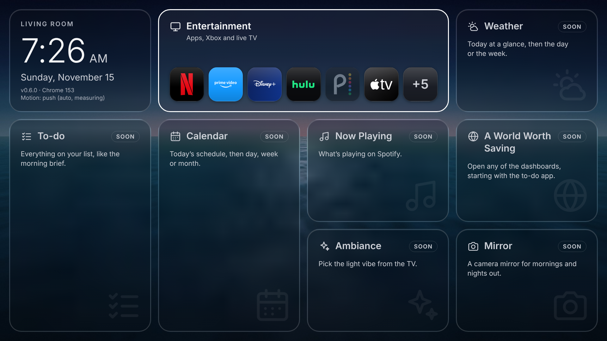

Out of the box:

- **Clock:** the time and the date. Open it for a big digital or analog clock, a 12-hour or 24-hour choice, and the hub's version and status.
- **Entertainment:** Netflix, Prime Video, Disney+, Hulu, Peacock, Apple TV, YouTube (TizenTube), Xbox on HDMI 1, Pluto TV, Twitch and a list of every app on the TV.
- **To-do:** a list kept on the TV, in levels: Must today, If you can, and passive reminders under Coming up. Add, tick off and change things with the remote.
- **Weather:** the temperature, today's high and low and the chance of rain, then the next 12 hours and the week. It finds the TV's city by itself.
- **Calendar:** today's agenda on the tile, then Day, Week and Month in the panel, from your Google calendars through the Pi.
- **Now Playing:** what is playing on Spotify: the album picture, the song and the artist, and a thin line that fills as the song goes. Open it for a big picture, the album, the time and where it is playing. In full screen, a classic-style visualizer in the album's colors fills the screen and the song moves to a small card in the corner. The Pi asks Spotify; set it up once with `./hub spotify login` (see [Now Playing](#now-playing)).
- **A World Worth Saving:** the book project at a glance: the next school visit, this week, and the to-do board, from the Pi.
- **Coming soon:** Ambiance and Mirror. These tiles hold their spot with a "Soon" tag until they're built.

Press OK on a tile to open it in a panel in the middle of the screen; the other tiles slide out of the way. The panel has a **Full screen** button. The tiles sit on a picture of the ocean, frosted like glass.

Now and then, when nobody has touched the remote for a while, Ian and his goldendoodle Ember (clay puppets) wander onto the screen in front of the tiles, do a little scene of 15 to 45 seconds and leave: a stroll, a game of fetch, a stolen sock, a nap at night. They are drawn smoothly between their stop-motion poses when the TV keeps up, and step as before when it doesn't. Any key sends them away at once. See [docs/clay.md](docs/clay.md); `clay: false` in `app/config.js` turns them off.

## Install on the TV

1. Open TizenBrew and go to **Module Manager**.
2. Choose **Add GitHub Module** and type `irosen419/tizen-takeover@main`. The `@main` matters: the hub follows the branch you name and always runs its newest commit (see [Updating](#updating)).
3. Back on the TizenBrew list, open **Home Hub**.

Apps that aren't installed show dimmed with "Not installed". Install the app from the Samsung store and reopen the hub.

## Remote

| Button | Home | Widget panel | Full screen | All apps list | Dashboard |
| --- | --- | --- | --- | --- | --- |
| Arrows | Move between tiles | Move between items and the Full screen button | Same as the panel | Up and down | |
| OK | Open the widget | Open the item, or switch to full screen | Open the item, or leave full screen | Open the app | |
| Back | Stays on the hub | Close the panel | Back to the panel | Back to the apps grid | Close the dashboard |

On the home screen, Up from a tile in the top row drops the **layout bar** (pick another layout; Back closes it), and Left from a tile at the left edge slides in the **About panel** (the hub's version and how things are going, see [About panel](#about-panel-the-version-and-status)). Right or Back closes the About panel and focus stays on the tile; Up and Down scroll it if it is taller than the screen. Keys pressed while it is open don't restart the wanderers' wait.

The Home button always goes to Samsung's own home bar. Open the hub from TizenBrew, or set it to start on its own (below).

## Xbox

The TV refuses remote key presses from an app running on itself, so the hub can't switch inputs directly. Two things make the Xbox item work:

1. Turn on HDMI-CEC: Anynet+ on the TV and HDMI-CEC on the Xbox. Then pressing the Xbox button on the controller switches the TV to HDMI 1 by itself.
2. Put a Home Assistant webhook URL in the Xbox item's `url` in `app/config.js`. The item posts to it, Home Assistant wakes the Xbox, and CEC switches the input.

Until `url` is set, the item shows a tip instead.

## Start the hub when the TV turns on

1. In TizenBrew, open **Settings**, then **Autolaunch Settings**, and pick Home Hub.
2. On the TV, turn on **Autorun Last App** (usually under Settings, General, Smart Features).

To get back to TizenBrew's own menu once autolaunch is on, close the hub, open TizenBrew and keep tapping Up while it connects. Up is the only key that skips autolaunch. **Disable Autolaunch** sits at the bottom of Autolaunch Settings.

Do this last, after everything else works, so TizenBrew's own menus stay easy to reach while you set things up. Samsung can still decide to show its own home bar after some updates.

## Settings

Everything lives in `app/config.js`.

### The Raspberry Pi

`HUB_PI` at the top is the Pi's address on the home network. Home Assistant runs there, and so will the later widget apps. Change it in that one place; the Xbox webhook is built from it.

### Layout

`layout` places each widget on a grid 12 columns wide and 6 rows tall. `x` and `y` are the top-left cell, `w` and `h` the size in cells. Make the tiles cover the whole grid so there are no gaps. `start` is the tile that has focus when the hub opens.

### Background and glass

`background` is the picture behind the tiles: a file next to `hub.html` (the default is `backgrounds/ocean.jpg`) or a full web address. Any 1920x1080 picture works; drop it in `app/backgrounds/` and point `background` at it. Set `background: ''` for the plain dark look. If the picture can't load, the hub falls back to the plain dark look by itself.

`glass: true` makes the tiles and panels frosted glass that show a soft blur of the picture behind them. `glass: false` keeps solid dark cards over the picture. A picture from another website still shows, but its glass is a plain tint without the blur, because the TV won't let the hub read pixels from another site.

### Motion

`motion` picks how a panel opens:

- `'push'`: the widget grows into the middle of the screen and the other tiles slide aside and shrink into a ring around it.
- `'expand'`: the widget grows over a dimmed screen.
- `'fade'`: a plain fade, the lightest on slow TVs.
- `'auto'` (the default) starts with push and times it on the TV. If push stutters twice, it drops to expand and times that; if expand stutters twice, it drops to fade for good. Three smooth runs keep the current one. The result is remembered until the next version of the hub.

Set `motion: 'fade'` (or `'expand'`) to pick one yourself. On a laptop, `?motion=push`, `?motion=expand`, `?motion=fade` or `?motion=auto` at the end of the address does the same for one visit.

#### Motion extras

`motionFx` (in `app/motion.js`) adds a few small touches, each with its own switch, all on by default:

- `quietTiles`: a tile that is only waiting (Calendar, A World Worth Saving or Now Playing waiting for the Pi, and the Mirror and Ambiance "Soon" tiles) shows one small, muted line, a little faded, with no big icon, so the tiles with real data lead. This one doesn't move, so it stays on in every motion mode.
- `ring`: one focus ring glides from tile to tile (190 ms) instead of the border jumping. A held arrow key jumps, so it keeps up.
- `stagger`: when a panel opens, its items (the Entertainment icons, the To-do parts) arrive one after another from the side of the tile it grew from, all in within half a second.
- `cover`: in Now Playing, the album picture flies from the page to the visualizer's card when full screen opens, and back when it closes.
- `bloom`: when an app opens from Entertainment, its icon grows to fill the screen, so the pause before the app looks meant.
- `activity`: when a live sync brings real news for a tile, that tile says so in a small chip in its lower left corner for about 2.4 seconds, with a light travelling twice around the tile's whole border (corners included), then the chip fades: **Incoming to-do** (a to-do that wasn't on the list, or an open one whose title, notes, due date or section changed on the Pi; a tick alone or a change made on this TV is not news), **Updating calendar** (events that changed), **Syncing data** (an A World Worth Saving snapshot with different contents), **Updating budget** (new budget figures) or **New song** (Spotify moved on to another song: a track id or title other than the last one, with a small music note that bobs). The new data itself just appears, as before. Never for the first data after the hub starts, never for a refetch that brings the same data, not while the wanderers are on screen, and not while a panel or full-screen page covers the home screen. One chip per tile, several tiles at once; the chip sits over the tile and never moves anything. The words follow the hub's Language (see [Adding text in both languages](#adding-text-in-both-languages)): the English is in `app/motion.js` and the Spanish in `app/i18n.js` under `motion.activity.todo`, `.calendar`, `.awws` and `.nowplaying` (`Nueva tarea`, `Actualizando el calendario`, `Sincronizando datos`, `Canción nueva`; the budget's is `budget.activity`, `Presupuesto nuevo`), looked up when the chip shows, so a language change applies to the next chip (and one still showing switches). When the tile already has focus, the white focus highlight is off along the whole border while the light travels round (the gliding ring is hidden, or without the ring the tile's own border takes the plain unfocused colour), so the light shows all the way round; it comes back as soon as the light's last lap ends, the focus moves or a panel opens. One line at 22 px or more on a 1080p screen. With "reduce motion" asked for, the chip only fades in and out, still. A widget calls `ctx.activity(kind)`. Every kind is one row of the kinds table (`KIND_TABLE` in `app/motion.js`), the only place they are defined: `kind`, `icon`, `en` (the English), `key` (its `app/i18n.js` key, where the Spanish is), `working` (the working chip's `{ en, key }`; `null` says the arrival words, `false` means no working chip) and `figure` (kept empty for a character or prop drawn with the chip later). A new kind is a new row. How long a chip or a working state lasts (the 2.4 s chip, 120 s working by default, 10 to 900 s, the 1.5 s settle) is shared by every kind and is not in the table. `HUB_FX.addActivity(kind, { icon, key, label, working, workingKey })` still adds a kind at run time (`label` may be a function that returns the words in the language active then).
- The **New song** chip (Now Playing, `activity: 'nowplaying'`): shown when the Pi's `nowplaying` data names another song than the last one this run. Never for the first data after the hub starts (or a reload), for a pause, a resume, a seek, the song's vibe arriving or nothing playing, and at most one chip in 8 seconds however fast the songs are skipped (a skip within those 8 s shows nothing, not a late chip). Like every chip it waits for nothing: under a panel, a full-screen page or the wanderers, in `'fade'` mode or on a slow screen there is none (the accent edge still comes). Guest mode hides only money, so it does not stop this chip, which never names the song. Now Playing has no working chip (`hub:working nowplaying` does nothing).
- Working chips (part of `activity`): while a sync is still on its way, the tile can say so before the data lands. Claude sends a say text through the Pi, `hub:working <kind>` or `hub:working <kind> <seconds>` (kind `todo`, `calendar` or `awws`; seconds 10 to 900, 120 when left out), and the first tile in the layout that declares that kind (`activity: '<kind>'` in its widget) shows a quieter chip: **Working on to-dos**, **Checking calendar** or **Gathering data** (Spanish: `Preparando tareas`, `Revisando el calendario`, `Reuniendo datos`). Its icon stays still and only breathes, one opacity loop and nothing else. When real news lands, the same chip turns into the arrival chip above (its loops run, the light laps the border, then it fades as usual). It also ends quietly on `hub:working <kind> done`, about 1.5 seconds after data that brought nothing new, or when its time is up, so it can never stay. A panel or a full-screen page takes it away, and it comes back when the home screen is uncovered while time is left; a layout switch moves it to the new layout's tile, and it survives the reload a layout with other tiles causes. A say text that starts with `hub:` is never shown as a message, even when this hub does not understand it. The words follow the hub's Language like the other chips (Spanish in `app/i18n.js` under `motion.working.<kind>`). `HUB_FX.addActivity(kind, { icon, key, label, working, workingKey })` gives an added kind its own working words.

- `edge`: a tile with something new to see gets a faint border in the chips' blue around its whole border (only its opacity fades in and out): with every arrival chip above, never with a working chip (and a budget change, **Updating budget**), and when a calendar event starts within the hour (once per event). It fades in, a white light travels once around the border (unless the chip's own light already does; the focus highlight is off meanwhile, as above), stays about a minute after the chip has gone and fades out; opening the tile clears it at once, and turning Guest mode on clears it from the money tiles. Never on focus. In `'fade'` mode or on a slow screen it is a still border without the travelling light or the fades. A widget raises one with `ctx.accent(reason)`.

They only move when the hub's own timing says the TV keeps up: in `'fade'` mode, after `auto` has stepped down from push, or below 40 frames a second, focus is the plain border again and everything else just shows, at once. Only `transform` and `opacity` ever animate. The light extras (the activity and working chips, and the accent edge with its travelling light) are the exception to the step-down: when `auto` stepped down from push but the TV still measures 60 frames a second or more without a stuttering run, they keep running while the ring glide, stagger, cover and bloom stay off. The About panel's **Motion** row ends in `extras on`, `extras: chips and light only (slow screen)` in that case, or `extras off (fade mode)` / `extras off (slow screen)` (in Spanish `extras activados`, `extras: solo avisos y luz (pantalla lenta)`, `extras desactivados (modo fundido)` / `(pantalla lenta)`; keys `motion.*` in `app/i18n.js`). `motionFx: false` turns them all off, `motionFx: { ring: false }` one of them; on a laptop, `?fx=off` does it for one visit (`?fx=ring,stagger` keeps only those). `node dev/motion-test.js` checks them (see [Preview and test](#preview-and-test)).

### Clock

The Clock tile follows the face chosen on the Clock page:

- **Digital:** only the time and the date, at any size, 12- or 24-hour. In a one-row strip the date sits beside the time, the weekday over the month and day; a longer one there takes its short form ("Wed", "Sep 30") rather than end in "...".
- **Analog:** only the analog face, as large as the tile allows and centred (in a one-row strip, the height of the row), with the date in its window: "SUN 15" when the face is big enough to read it (two rows and up), just "15" on a small face (a strip, 1×1), and no window on a tiny one. No digital time anywhere on the tile. The second hand steps once a second.

Press OK on it to open the Clock page. At the top right of the page are the choices, picked with the arrows and OK:

- **Face:** **Digital** (a big time with the full date under it, the default) or **Analog** (a round face with ticks and 12, 3, 6 and 9, the day and date in a small window in its lower half, and the date beside it, with no digital time). The second hand steps once a second; nothing sweeps.
- **Clock:** **12-hour** (`9:41 PM`, the default) or **24-hour** (`21:41`), on the page and the tile. Only shown with the Digital face; on Analog it doesn't apply, and is kept for when you go back to Digital.
- **Language:** **English** (the default) or **Español** (Latin American Spanish), the hub's language, on both faces. The label turns into **Idioma**; the two names always stay in their own language, so you can find your way back. Today it changes Word of the day (its title, labels and definitions) and the money tiles: Earned vs spent, Daily room, Card day, Goals and the "New charge" banner (their titles, words and dates; amounts stay `$1,265`, and goal names, transfer labels and merchants stay as the budget app sends them). The Clock itself, the other A World Worth Saving tiles and the hub's own buttons stay in English for now. Set it on the Clock page; `?lang=es` on the page's address tries it for one load without saving.

The tile changes as soon as you pick, behind the page. All three choices are remembered on this TV. **Full screen** makes the clock as large as the screen allows. Back closes the page, as everywhere.

### About panel (the version and status)

The hub's own facts live in the **About panel**: press Left on a tile at the left edge of the home screen and a narrow strip slides in from the left, in the same glass as the layout bar. Right or Back closes it. It can't open over a panel, a full-screen page or the layout bar. It shows, in groups:

- **This hub:** **Version** (for example `v0.29.1 (newest)`; `(newest)` means GitHub confirmed this is the newest commit of the branch), **Browser** (`Chrome 63 · Tizen 5.0`) and **Motion** (`push (auto, 57 fps) · extras on`; `measuring` means auto is still timing, `(config)` or `(URL)` means the mode was set by hand, and the end says whether the [motion extras](#motion-extras) run), then **Weather picture** when the weather picture is still or off (see Weather), and **Scripts** only when one of the hub's script files failed to load: `logos.js loaded on a later try` (it was fetched again and the page loaded again by itself) or `logos.js did not load` (see [When a file fails to load](#when-a-file-fails-to-load)).
- **Updates**, only when there is something to say: **Live updates** (see [Live updates](#live-updates)) and **Version check** (see [Updating](#updating)).
- **Now Playing:** **Visualizer**, once the full-screen page has been shown: the level (`radiant`, `sharp`, `sharp-lite`, `classic`, `classic-lite`, `glows` or `still wash`), the frame rate it measured, at the canvas levels how long a frame takes to draw (`14 ms a frame`; a 30 fps frame has 33 ms, so this shows the headroom), the tempo with where it came from (`124 BPM from features`, `guessed from genres` or `(no vibe)`) and, for the classic levels, the scene last shown (`kaleidoscope`). See [Now Playing](#now-playing).
- **Wanderers:** the clay wanderers: **Now** (what they are doing, or when they are due back), **Visits**, **Last visit**, **Drawing** (how the last visit was drawn: `Smooth, 58 frames a second`, or `Stepped: the screen managed 14 frames a second` when the TV couldn't keep up), **Loading** (how long the files took) and **Last problem** (only when there was one). See "If they don't show up" in [docs/clay.md](docs/clay.md).

Everything in it changes by itself, once a second, while it is open. It doesn't count as busy: the wanderers keep coming while it is open, behind it. `HUB_TEST.about` (`open()`, `close()`, `isOpen()`, `rows()`) reads it in a laptop browser and in the tests.

### Entertainment

`widgets.entertainment.sections` lists the items, in groups. Each item has a `kind`:

- `app` opens an installed app. `match` lists names to look for. The first exact match wins, otherwise the shortest name that contains the text.
- `tizentube` opens the TizenTube module through TizenBrew.
- `input` presses a remote key. This TV refuses key presses from the hub, so it's kept only for TVs that allow it.
- `webhook` posts to a URL, for example a Home Assistant webhook.
- `dashboard` opens a web page full screen, for example Home Assistant or Grafana.
- `allApps` opens the list of every app.

`logo` picks a brand logo from `app/logos.js`. Without one, the item shows its first letter. `sub` is the small line under the name.

The home tile shows the first six logos. The panel shows them all; full screen groups them by section.

#### Adding a dashboard

Uncomment the Dashboards example and point `url` at the page. Some sites refuse to load inside another page. If yours shows blank, that site blocks framing and needs its own setting changed.

### Weather

The tile shows the city, the temperature and the sky now, and today's high, low and chance of rain. The panel has two views, picked with Left and Right at the top: **Day** (now, feels like, wind, rain today, sunrise and sunset, then the next 12 hours with a temperature curve; if the screen is short on room, the hours show their temperatures as a plain row instead of the curve) and **Week** (seven days, each with its rain chance and its low-to-high range on one shared scale). Full screen shows both side by side, under the place's date.

`widgets.weather.location` says where the forecast is for. It takes one of three forms:

- `''` (the default): the TV finds its own city. It asks a public lookup service (ipwho.is, then get.geojs.io if that one doesn't answer) which city its internet address is in, and keeps the answer on the TV, not in this file. If the lookup picked the wrong city, **Wrong city?** in the panel asks again, trying the other service first; the old city stays until the new one's forecast is in. If it still gets it wrong, set the city yourself. If neither service answers (no internet yet), the tile says "Can’t find your city yet" and keeps trying. If they answer but can't place the TV, it says "Set your city": add one to `location`.
- A city name, such as `'Lisbon'` or `'Portland, Oregon'`. It's looked up once. The part after the comma picks between towns with the same name.
- An exact spot: `{ name: 'Home', latitude: 38.72, longitude: -9.14 }`.

`units` is `'fahrenheit'` (wind in mph) or `'celsius'` (wind in km/h).

**The picture behind the weather.** The tile and the panel have a quiet picture of the sky behind the text, made from the real forecast: a sun with slow rays by day (warmer at dawn and dusk), a moon glow and twinkling stars by night, clouds drifting across (faster in wind, with streaks of wind on dry days), rain and drizzle falling at a slant, snow drifting down, banks of fog, and for a thunderstorm dark clouds with a pale flash and a bolt now and then. The more rain or snow there is, the more falls. Only transform and opacity ever animate, a kind is about a dozen layers, and the tile's picture pauses while the panel is open. Wind is 14 mph (or km/h on Celsius) and up for "windy", 28 for "very windy".

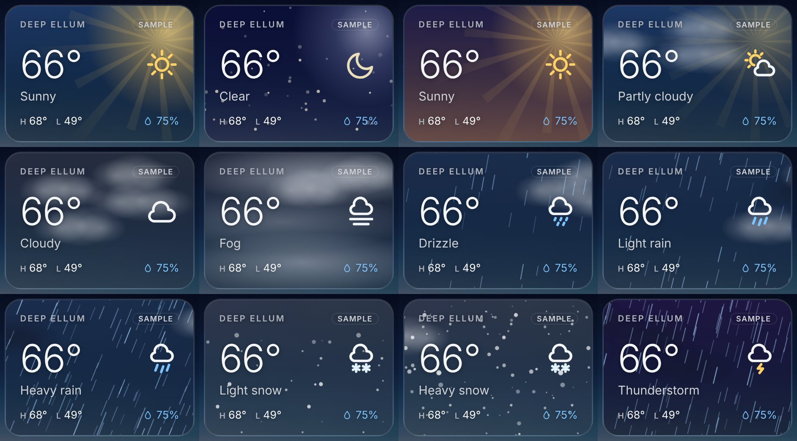

If the TV can't draw it smoothly, the picture stays but stands still ("calm"). The hub decides by itself: it counts the frames a second the page really draws with the picture moving, 6 seconds after it starts, and goes still under 30 (the result is kept on the TV for 6 hours and for this build), or straight away when the hub has already fallen back to plain fades. The About panel's **Weather picture** row appears only when the picture is not moving, and says why: `Still, this TV drew 14 frames a second`, `Still, the hub is on plain fades`, `Still, set to calm (config)` or `Off (URL)`. A moving picture is plain to see, so it gets no row. To decide by hand, set `widgets.weather.scene` in `config.js` to `'calm'` (always still), `'full'` (always moving) or `'off'` (no picture), or add `?weatherscene=calm` (`full`, `off`) to the page's address. To preview a kind on a laptop, add `?wxscene=rain-3`, `snow-2-night`, `storm`, `clear-dusk`, `partly-day`, `cloudy-wind`... (kinds: clear, mostlyclear, partly, cloudy, fog, drizzle, rain, snow, storm; levels 1 to 3; then `day`, `night`, `dawn`, `dusk`, `wind`). `node dev/weather-scene-test.js` checks all of it.

Forecasts come from [Open-Meteo](https://open-meteo.com/), which is free and needs no account. The panel credits it, as its licence asks. The TV asks Open-Meteo directly; if the TV's browser can't reach it, the hub's local helper (`service.js`) asks for it. The forecast updates every 20 minutes while the hub is on screen, and right away when you come back to the hub after a while. When it can't update, the tile keeps the last forecast and says "as of" and the time it was fetched. After 24 hours without an update the old forecast is dropped and the tile says "No forecast right now" with the time of the next try. **Update now** in the panel tries at once. If the TV's clock jumps back, the hub updates straight away instead of waiting.

### Word of the day

One Spanish word or phrase a day (Latin American Spanish), with its English, from `app/wotd-data.js`: 366 entries, picked by the TV's local day of the year (1 January is the first), so the word stays the same all day and changes just after midnight. They start easy (A1, January to March), then A2 (April to August) and reach B1 by December, with seasonal words near their days (Día de Muertos, Acción de Gracias, Nochebuena). Nouns carry their article (el, la, los, las).

The Spanish word is always the big one and the English the smaller companion. A 1-column tile shows only the Spanish word; a strip shows "darse cuenta · to realize" on one line; two rows add the part of speech and the Spanish example; three rows add how to say it ([DAHR-seh KWEN-tah]), the definition and the example's English. OK opens everything: the date and level, both definitions and both examples; Full screen makes it bigger. With the hub in Spanish (Language on the Clock page) the title, labels, date and first definition are Spanish (Palabra del día). `node dev/wotd-test.js` checks it (see [Preview and test](#preview-and-test)).

## To-do

A to-do list kept on this TV. Every item has a **level**:

- **Must today** (red): a colored edge, a red **MUST** pill after the title (so it never rests on color alone) and a faint red wash behind the row.
- **If you can** (yellow): a yellow edge, no pill. This is the default: an item added on the TV, from `./hub todo add` without `--level`, and every older item (the former Now, Next and Waiting on) is "If you can".
- **Passive** (green): a reminder, not a task. No tick box and no section of its own: it shows as a dimmed **Coming up** footnote at the bottom of the tile and the panel, one line each with a small green dot and its date (Today, Tomorrow, Nov 19), only from 2 days before it is due (`COMING_UP_DAYS` in `app/widgets/todo.js`), or always when it has no date. It can be cleared (OK) or removed like any other item.

While a must-do due today (or earlier, or with no date) is open, a rounded red strip at the top of the tile and the panel says **1 must-do today: Take weekly shot** (**2 must-dos today: ...** for more), and the tile keeps a red edge. Before 5 PM the strip is still. From 5 PM it pulses slowly (one breath every 3.5 s), a little stronger as the evening goes (its swing grows from 0.15 at 5 PM to 0.55 at midnight, updated every minute); once a must-do is late (after midnight, or a must-do with no date made on an earlier day) it pulses at full strength and the item says **Overdue** until it is done. Only opacity animates (a glow layer over the strip; the shadow itself never changes); in the hub's fade mode, or with "reduce motion" asked for, it does not pulse and the glow just stays.

The tile shows the strip, how many items are open, Done today, the first few items (must-dos first) and the Coming up footnote. Anything past its due date says **Overdue**.

Open the tile to see the whole list: **Must today**, **If you can**, **Done today**, then the **Coming up** footnote.

- **Add something:** the box at the top has focus when the list is empty. Press OK and type with the TV's keyboard, then press Done. The new item goes to the top of If you can and the box is ready for the next one. Back stops typing and keeps the text.
- **Tick it off:** OK on an item. It stays where it is, crossed out, until you close the list, so a wrong press is fixed with another OK. Next time it shows under Done today. OK on a Done today item puts it back.
- **Change its level:** press Right on an item to reach its two round buttons: the arrow moves it along must, optional, passive and round again (its label says where: **To If you can**, **To Coming up** or **To Must today**), the bin removes it.
- **Remove it:** OK on the bin (**Remove**), then OK again on **Press again**. Moving away or pressing Back cancels.

The words follow the hub's Language (Spanish in `app/i18n.js` under `todo.*`: Para hoy, Si puedes, Próximamente, CLAVE).

**Levels from the Pi:** `./hub todo add "..." --level must|optional|passive`, `./hub todo level "..." passive`, and the mailbox's `todo.add` with `level` and `todo.level` (server 0.6.0). A Pi server older than 0.6.0 refuses `level` there, so a level can also ride in the notes as a tag, `[level:must]` or `[level:passive]`: the TV reads it and never shows it (nor a `[cal:...]` tag, which the calendar converter uses to remember what it converted). A level set on the TV reaches any Pi server, old or new, and comes back.

Done items stay under Done today until the end of the day, then they're cleared.

A USB or Bluetooth keyboard plugged into the TV works too: with the box focused, just start typing, and Enter adds the item. Backspace deletes a letter while you type.

Full screen shows Must today on the left, If you can and Done today on the right, and Coming up across the bottom.

**Notes:** an item can carry notes (up to 300 characters), such as "Oat milk, not dairy". They show under its title in smaller gray text: one line on the tile, up to three in the panel and four in full screen, cut with "..." if longer. An item without notes shows nothing extra. Notes are added from the Pi or by Claude (`./hub todo add "Buy milk" --notes "Oat, not dairy"`, `./hub todo notes "Buy milk" "..."`, or the mailbox's `todo.add` with `notes` and `todo.notes`), not from the remote. Ticking, moving or removing an item on the TV keeps its notes, and a change to them shows on the TV by itself, with no restart.

The list is saved on the TV itself. With [live updates](#live-updates) on, it is also kept on the Pi and changes go both ways; the line under the title says where the list is: `On this TV` (no Pi), `In sync`, `Saved here, 2 to send` (changed while the Pi was away; sent when it's back) or `Saved here` (the Pi is away, nothing waiting). A warning shows on the tile if something goes wrong:

- **This TV isn't saving the list.** The TV won't let the hub save anything. The list works until the hub closes, then it's gone.
- **Couldn't save the last change.** The TV's storage may be full. The change is kept until the hub closes, and the next change tries again.
- **The saved list couldn't be read, so a fresh one was started.** The saved copy was damaged. It's kept on the TV as `homeHub.todo.v1.bad` in case it can be recovered.

## Calendar

Your calendars, read by the hub server on the Raspberry Pi (see [Live updates](#live-updates) and [pi/README.md](pi/README.md) for the secret iCal links). Everything is shown in the Pi's time zone (`HUB_TIMEZONE`, America/Chicago by default), whatever zone the TV is set to. Each calendar has its own color; the panel's foot names them.


The tile shows today's date, all-day events, then what's still to come today (ended events drop off; one that is on now says **Now**). With nothing left it says "Nothing else today" and the next event, for example "Next: Tomorrow 9:00 AM Dentist".

The panel has three views. The row at the top holds **Today**, **Day**, **Week** and **Month**; Left and Right on it switch views at once, Down goes into the calendar.

- **Day:** the hours of one day with all-day events above them, events side by side where they overlap, a red line for now, and the chosen event's details on the right. Left and Right go to the day before or after; Up and Down pick events. Past events are dimmed.
- **Week:** seven columns, Sunday first (change `WEEK_START` at the top of `app/widgets/calendar.js` for Monday). Left and Right pick the day, Up and Down its events, OK opens that day.
- **Month:** colored dots for days with events and the chosen day's list beside the grid. The arrows move by day and week (into the next or last month at the edges); OK opens the day.

Up from the first event (or the top row of the month) goes back to the row of tabs. **Today** jumps back to today. Back closes the panel, as everywhere.

When something is missing the tile says so in plain words: "Calendar needs the Pi" (live updates off, or the Pi never reached), "Loading the calendar…", "No calendars set up yet" (no links in the Pi's `.env`), "Nothing coming up", "Can't reach the Pi". A calendar the Pi couldn't read shows as "Work: couldn't be read". The TV keeps its last copy of the calendar, so the tile has something to show straight after the TV turns on; when that copy is old and the Pi is away it says "Last updated 2:40 PM".

## Now Playing

What is playing on your Spotify. The Raspberry Pi is the only thing that talks to Spotify (it holds the app's secret and your sign-in); the TV only receives the song, the artist, the album and the picture over the live line. **Setup is a few minutes, once:** see "Spotify" in [pi/README.md](pi/README.md).

The tile changes with its size on the grid (see [docs/tile-sizes.md](docs/tile-sizes.md)): one column or a narrow strip is just the album picture; a strip shows the picture with the song and artist on one line each; a 2-row tile puts the picture beside the song, artist and a "Now playing" label with three little moving bars; a tall narrow tile stacks the picture over the words. A thin line at the bottom fills as the song plays. Long titles wrap, then end in "…". Press OK for the page: a big picture, the song, artist and album, the time played and the length, and chips for where it plays ("On Living room"), Shuffle and Repeat. Its Full screen button makes it bigger.

When nothing plays, it says so and keeps the last song, dimmed, as "Last played". Other plain-words states: "Not connected yet" (run `./hub spotify login` on the Pi), "Not set up" (no ID and secret in the Pi's `.env`), "Can't reach Spotify" (a small notice under the last song; it keeps trying), "Can't reach the Pi" (last song kept, marked), and "The Pi needs an update".

### The visualizer (full screen only)

In full screen, while a song plays or is paused, a visualizer in the spirit of the old Winamp, MilkDrop and iTunes ones fills the whole screen: bright lines that roam everywhere and leave trails, tunnels and swirls behind, in the album picture's colors. The song shrinks to a small card in the upper left (the picture, the song in two lines, the artist, the album, the time and the chips, on dark glass). The small page and the tile never have it.

It plays six scenes, a phrase each (16 or 32 beats), in an order that belongs to the song (the same every time it plays):

- **Spirograph:** looping hypotrochoid pens that wander and turn.
- **Tunnel:** polygons or stars rushing out of a wandering point, a new ring on each beat.
- **Kaleidoscope:** a few pens mirrored 6 to 12 times around the middle.
- **Ribbons:** two or three waves across the screen that leave silky sheets.
- **Starburst:** sparks and rays thrown out on each beat, swirled into a whirlpool.
- **Lattice:** a turning wireframe of a rose curve that morphs.

It follows the song's **vibe**, which the Pi looks up once per song (see "Spotify" in [pi/README.md](pi/README.md)): the tempo sets the beat (a brief kick in width, brightness and zoom; never faster than 2.5 a second, so fast songs kick on every other beat), energy how many pens and sparks, how thick and bright and how fast the trails move, danceability against acousticness whether it leans to the sharp scenes (tunnel, kaleidoscope, starburst) or the flowing ones (spirograph, ribbons, lattice), and mood (valence) how far the colors swing round the album's hues. The intensity eases in at the start of the song, swells and settles at the end. Everything is timed from the song's position, so a seek lands in the right scene; paused, it settles into a still picture and stops drawing; the next song morphs out of the last one. There is no sound to react to (Spotify sends none): it moves at the song's speed and feel, not to its actual beats. A "124 BPM" chip shows when the tempo is the song's real one. A song with no vibe (a podcast, a song ReccoBeats doesn't know, the lookups turned off) gets a gentle 100 BPM; a song known only by its artist's genres gets a guess. When the picture can't be read for colors, the mood picks them.

It draws on a canvas, stretched over the screen: each frame, the last one is drawn back a little zoomed and turned and faded into a deep tint of the album's main color, then a few new shapes go on top. At the top level (`radiant`, since v0.26.0) the canvas is 960 × 540, every line gets a soft wide halo under its sharp core, glowing sparks and drifting motes of light (three depths, brighter on the beat) are stamped on, a bloom (the picture shrunk and stretched back over itself) is added on a second canvas so it never feeds back into the trails, and a soft dark vignette rests the edges. It aims for 60 frames a second and drops to 30 when drawing a frame takes more than 11 ms. A frame that takes more than 24 ms steps it down at once; otherwise, after it starts it times its own frame rate twice, and two poor results step it down one level. Below it, `sharp` and `sharp-lite` (since v0.28.3) keep the big canvas, or most of it, at 30 frames a second and shown as it is, without the bloom, halos and motes: the trails fade a little sooner and move a little less per frame and the new lines go on stronger, so lines stay crisp instead of going soft as at `classic`. Every canvas level keeps track of how long a frame takes; a step down from one skips a rung above `classic` whose frame, estimated from that (by its pixels, and about a quarter of the cost once radiant's extras are gone), would take over 28 ms. `classic` and below are always tried. The answer is remembered on this TV until the next version:

| Level | What it shows |
|---|---|
| `radiant` | 960 × 540, 60 fps (30 when slower); halos, sparks, motes, bloom and vignette |
| `sharp` | 960 × 540 at 30 fps, one canvas shown as it is; crisp lines over shorter trails, glowing sparks |
| `sharplite` | 720 × 405 at 30 fps, the same with three quarters of the shapes and plain sparks (shown as `sharp-lite`) |
| `classic` | 480 × 270 at 30 fps (the v0.21.0 look); where lines cross their colors add up toward white |
| `lite` | 320 × 180 at 24 fps, fewer pens and sparks, plain colors |
| `glow` | soft glows that drift, moved by the graphics chip alone; the card stays |
| `wash` | a still wash of the album's colors, and the big picture layout back |

The plainest motion setting (`fade`) starts at the still wash.

- **Turn it off:** `widgets.nowplaying.visualizer: false` in `app/config.js` (or `'radiant'`, `'sharp'`, `'sharplite'`, `'classic'`, `'lite'`, `'glow'` or `'wash'` to fix a level; `'full'` means `'radiant'` and `'sharp-lite'` means `'sharplite'`). Off, the page is the big picture layout as before.
- **Try a level:** add `?viz=off`, `?viz=wash`, `?viz=glow`, `?viz=lite`, `?viz=classic`, `?viz=sharplite`, `?viz=sharp` or `?viz=radiant` (`?viz=full` is the same as `radiant`, `?viz=sharp-lite` as `sharplite`) to the address.
- **See what it chose:** the About panel's **Visualizer** row.

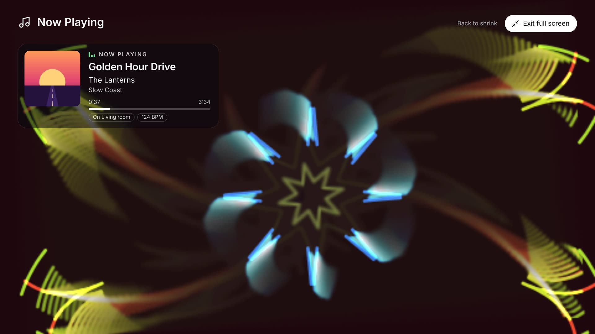

## A World Worth Saving

Six tiles for the book project, all with a globe icon. They read two things from the hub server on the Raspberry Pi:

- **Calendars, by name.** Visits come from the calendar named "School Visits"; project dates from "A World Worth Saving". Any other calendar on the Pi (the family one, say) never shows on these tiles. The names are in `app/config.js`, under `widgets.awws.calendars`.
- **A snapshot of the project**, sent to the Pi by a Claude sync through the mailbox, or by hand with `./hub awws set` (the file is described in [docs/awws-snapshot.md](docs/awws-snapshot.md)): the to-do board, handoffs, librarians, books, the rewrite, money and reach. Each copy that arrives is checked and the tiles redraw only when what they show changes.

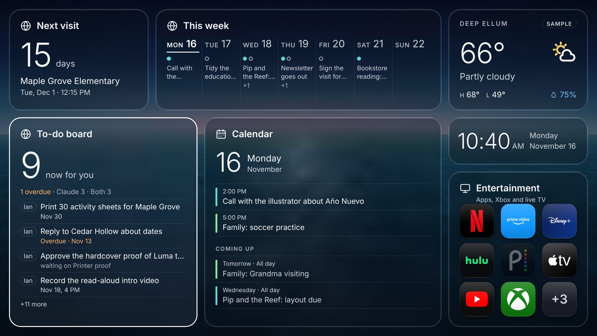

The tiles:

- **A World Worth Saving** (`awws`), the Glance: the countdown to the next school visit, how many things are waiting on you now, and replies waiting. At 6 × 4 and bigger it is a dashboard of four parts: Next visit, This week, Now for you and Progress.
- **Next visit** (`awws-visits`): "15 days" to the next visit, the school, the day, time and place, then the visits after it.
- **This week** (`awws-agenda`): project dates and to-dos that are due, day by day. A wide tile has seven day columns with a dot per item; a hollow dot is a to-do.
- **To-do board** (`awws-todo`): how many Now items are yours, the overdue count in amber, then the items with their owner (Ian, Claude or Both), due date and what they wait on.
- **Reach** (`awws-reach`): site visits this week as the big number, up or down from last week, and a line of the last 14 days; then buy clicks, flier scans by school, and newsletter subscribers with the day they were last counted. Subscribers are counted by hand for now, so today it shows "2 subscribers, at last check Nov 16"; the visits take over as the big number once the sync sends them. Its panel has each figure with a longer trend.

- **Earned vs spent** (`awws-money`): the net so far (total earned minus total spent since the first month on record, the same figures as Ian's AWWS profit page), big, green when it is up and coral when it is down; "earned $1,265 · spent $1,841"; then a pair of bars per month (earned green, spent coral) and, on a tall tile, the next transfer. It never shows a balance. It is on the **AWWS money** layout.

Librarians and Books (`awws-outreach`, `awws-pipeline`) hold their spot with a "Soon" tag for now. [docs/tile-sizes.md](docs/tile-sizes.md) says what each tile shows at each size.

Reach is a real tile but is on no layout yet. To place it, on the Pi run `./hub layout show`, change one tile in the list to `{"widget": "awws-reach", "x": 9, "y": 3, "w": 3, "h": 3}` (any free spot and size), and send the list back with `./hub layout set layout.json`. The Glance's panel opens Reach as well.

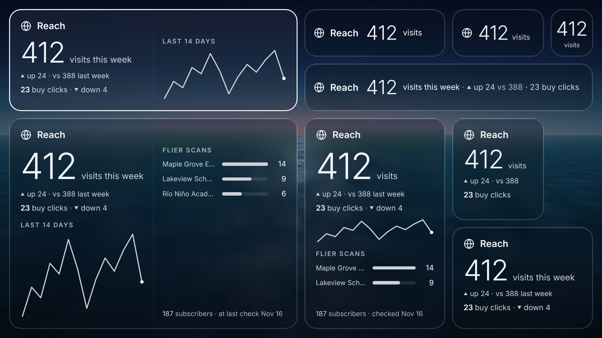

Three layouts in the switcher use them: **AWWS desk** (above), **AWWS one screen**, the Glance as a big dashboard with Today, Weather and Calendar beside it, and **AWWS money**, the Glance, Earned vs spent and the To-do board with Calendar and Entertainment.

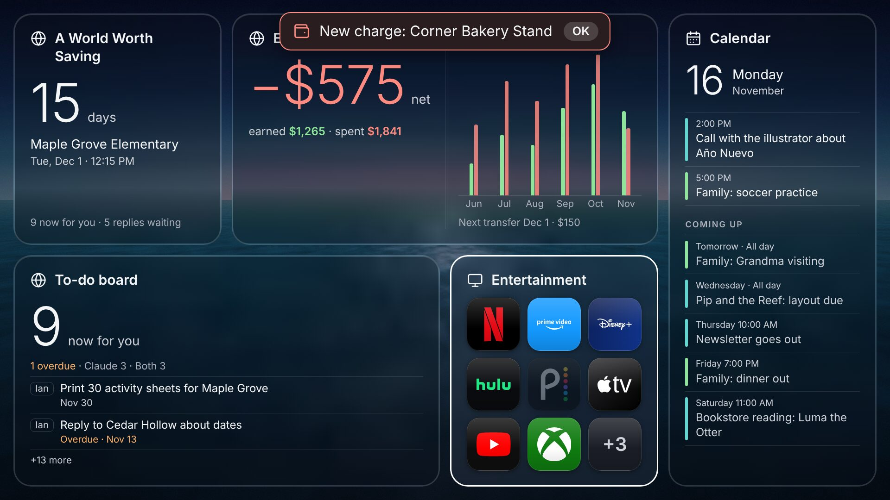 **Main** keeps the Glance at 3 × 4.

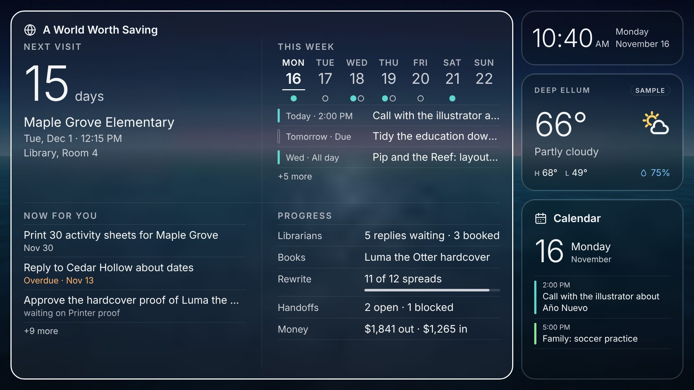

Open the Glance and it lists Next visit, This week, To-do board and Reach with a line each; OK opens one in the same panel, and Back goes back to the list. In full screen it shows the dashboard instead, and OK on a part opens it. In the To-do board, Left and Right pick whose items show: All, Ian, Claude or Both.

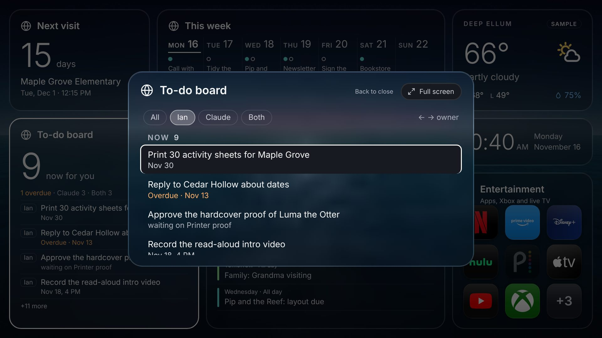

When something is missing a tile says so instead of going blank: "Not synced yet" (no snapshot has reached the Pi yet), "Needs the Pi" (live updates off or the Pi never reached), "Can’t reach the Pi", "Loading…", "No “School Visits” calendar on the Pi", or "School Visits couldn’t be read". Under the title, "as of 7:10 AM" means the data is older than it should be (the calendar after 30 minutes, the snapshot after 2 hours). The TV keeps its last copy (`homeHub.awws.v1`), so the tiles have something to show straight after the TV turns on.

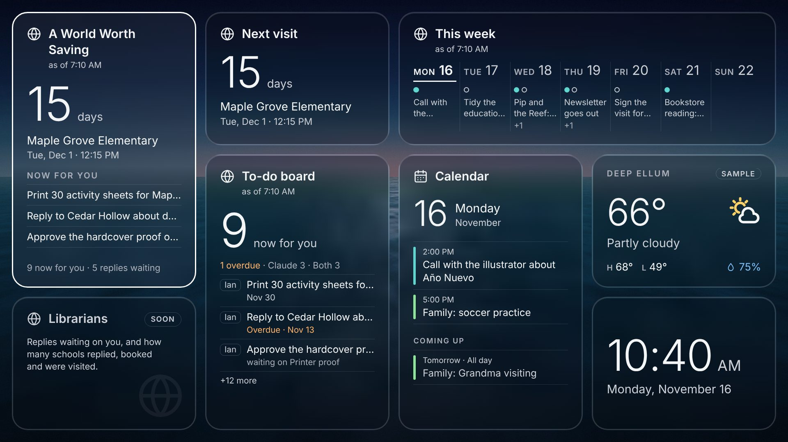

Settings, in `app/config.js`:

```js
widgets: {
  awws: {
    calendars: { visits: ['School Visits'], awws: ['A World Worth Saving'] },
    showMoney: true
  }
}
```

`showMoney: true` adds a money line ("Spent $1,841 · earned $1,265") to the Glance's list and dashboard and fills Earned vs spent. Ian said yes to money on the TV on 2026-11-16; set it to `false` to keep money figures off the TV (for guests, say): the line goes and Earned vs spent says "Money is hidden". Every word on the tiles is in one `STRINGS` object at the top of `app/widgets/awws.js`; `window.HUB_AWWS_STRINGS` replaces any of them (the tests use it to try the tiles in Spanish, which runs about a quarter longer).

To try it on a laptop, with `node dev/preview.js` running, send the sample snapshot to the preview's hub server:

```
node dev/awws-sample.js | HUB_TOKEN=preview-token-not-a-secret-000000 node pi/hubctl.js awws set -
```

Add `--reach subscribers` to `node dev/awws-sample.js` (only the hand-counted subscribers, as today) or `--reach traffic` (visits, buy clicks and scans, no subscribers) to try Reach with the other shapes of its data.

The preview's sample calendars aren't named "School Visits", so Next visit says that calendar is missing; the tests and screenshots bring their own.

`node dev/awws-test.js` runs the real hub and the real hub server from `pi/` in a headless browser (Playwright), with the clock fixed at Monday 16 November 2026, 10:40 AM in Chicago and the sample calendars and snapshot from `dev/awws-sample.js`. It checks every AWWS tile at 11 sizes in English and in Spanish (no console errors, never blank, nothing clipped, no type under 0.85rem on a tile or 1rem in a panel), that a Family event never shows, the countdown across midnight in Chicago (with the TV in Chicago and in Tokyo), overdue in amber, a calendar without a snapshot and the other way round, an old Pi with no snapshot, broken snapshots and a broken saved copy, the same snapshot sent twice, the Glance's list and Back, the owner filter, full screen, and the layout switcher with five layouts. For Reach it checks every size in both languages with subscribers alone, traffic alone and both, its panel and full screen, no reach section, and the Glance opening it; and that `showMoney` shows and hides the money line. It needs port 8095 free.

`node dev/money-test.js` does the same for Earned vs spent and the budget tiles: every size in English and Spanish, the panels and full screen, the colors (green up, coral down; amber, coral and green for the room), old data dimmed with "as of", `showMoney: false` and `budget.show: false`, the "New charge" banner (OK and Back dismiss it, a dismissed one stays gone after a reload), the AWWS money and Budget layouts, and the empty states. It needs port 8095 free.

`node dev/money-i18n-test.js` checks the same tiles with the hub in Spanish (`homeHub.lang`): the Spanish titles, words and dates from `app/i18n.js`, amounts and the budget app's own text left as sent, every tile at 11 sizes and each panel and full screen with the real Spanish and again with every Spanish money string 25% longer (with Á, É, ñ, ¿ and ¡), the empty states and the banner in Spanish, and a language change redrawing the tiles, their titles and an open panel. `--shots <folder>` also saves the `docs/screenshots/money-en-*` and `money-es-*` pictures. It needs port 8095 free.

## Budget

Three tiles with a wallet icon, filled by the budget app on the Pi. The app works out the totals and sends them to the hub server on the same Pi (`POST /api/budget` with the token); nothing goes through the cloud. The shape is in [docs/budget-snapshot.md](docs/budget-snapshot.md). Only totals ever reach the TV: never a balance, a transaction list or an amount on an alert.

- **Daily room** (`budget-room`): what is left to spend per day, big; amber when it is under the daily cap, coral below zero, green at the cap. A bar of the cap, "of $60 a day · 9 days left", "through Tue, Nov 24", and what it will be once a pending refund posts.
- **Card day** (`budget-card`): "Thu, Nov 19 · in 3 days", then "Covered" in green or "Short by $120" in coral, the transfers that cover it and the next paycheck.
- **Goals** (`budget-goals`): one row per goal with a bar, green when clean or under, blue on pace, coral when over.
- **New charge**: when the app reports a charge at a merchant that was cut, a banner across the top says "New charge: Corner Bakery Stand" (never the amount). OK or Back dismisses it from any screen, and it clears itself after 5 minutes; the TV remembers which it has shown.

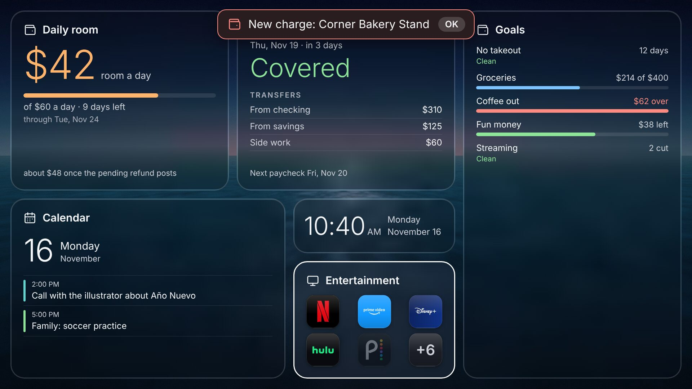

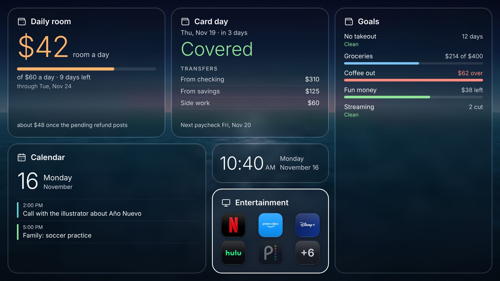

The **Budget** layout in the switcher places the three tiles with Calendar, Today and Entertainment. Until the app sends anything the tiles say "Waiting for the budget app"; after 2 hours without a new snapshot they say "as of 9:10 AM" and dim. `widgets.budget.show: false` in `app/config.js` hides it all on that TV. On the Pi, `./hub budget show` says when the last snapshot came and what is in it (dates, counts and states only), and `./hub budget clear` removes it. To try it in the preview: `node dev/budget-sample.js | HUB_TOKEN=preview-token-not-a-secret-000000 node pi/hubctl.js budget set -`.

`node dev/awws-shots.js` takes the `docs/screenshots/awws-*` pictures, each in English and in Spanish (`-es`): the layouts, the size sheets, the panels and the states. A layout holds each widget once, so the Reach size sheets are put together from one page per tile. `--out <folder>` saves them elsewhere, `--scale 2` doubles the pixels, `--only <text>` takes only the shots whose name holds the text, and `--clip <folder>` records a short walk through the tiles into that folder instead of the pictures (mp4 with ffmpeg, otherwise webm).

## Live updates

A small server on the Raspberry Pi (`pi/`) lets Claude steer the screen ("show me the weather", "go home", a short message at the bottom) and keeps the to-do list, so "add milk to my to-do list" shows up on the TV by itself. The TV keeps one open line to the Pi and redraws when something changes. The TV being off, or the Pi being down, never breaks the hub: it draws from what it saved and tries again quietly. The design is in [docs/live-updates.md](docs/live-updates.md); installing and running the server is in [pi/README.md](pi/README.md).

The setting is `live` in `app/config.js`:

```js
live: { server: HUB_PI + ':8097' },
```

`server: ''` turns live updates off, and the hub works exactly as before. On a laptop, `?live=http://127.0.0.1:8097` in the address uses another server for one visit, and `?live=off` turns it off.

**Live updates** in the [About panel](#about-panel-the-version-and-status) says how it's going, in small text, never a pop-up:

| Live updates says | Meaning |
| --- | --- |
| nothing (no row) | Live updates are off, or this TV has never reached the Pi (it keeps trying quietly) |
| `connected` | Connected |
| `lost the Pi at 7:10 AM` | Was connected, the Pi can't be reached now. The hub uses saved data and retries |
| `the Pi refused this TV` | The TV isn't on the Pi's allowed list (`HUB_TV_IPS`). Retries every 5 minutes |
| `unexpected reply from the Pi` | Something else answers at that address. Retries every 5 minutes |
| `the hub needs an update` | The Pi's server is newer than this hub understands |

Commands the Pi can send: `show` a widget (`weather`, `todo`, `calendar`, `entertainment`, optionally full screen), `home` (close whatever is open), `say` a short message for a few seconds, and `reload` (which goes through the loader, so it also picks up the newest version). A command sent while the TV is off is dropped, so nothing old fires when the TV turns on.

### For widget authors

Widgets get `ctx.live`: `status()` (`{ state, text, since }`), `get(resource)`, `on(resource, fn)` (`fn(data, rev)` whenever new data arrives), `onStatus(fn)`, `post(path, body, cb)` and `everConnected()`. The hub also calls every widget's `onStatus` hook when the live state changes. `ctx.live` is `undefined` when `live.js` isn't loaded. Normally every file comes from one commit, but when GitHub can't be reached on a TV's first start the hub runs from the branch, where jsDelivr can serve a mix of old and new files, so always check it first. `ctx.setTileSub(text)` changes the small line under the tile's title. The to-do widget (`app/widgets/todo.js`) is the worked example.

### Preview and test

`node dev/preview.js` also runs the Pi's server on `127.0.0.1:8097` (with a made-up token, data in `dev/.live-data`). Open http://127.0.0.1:8090/?live=http://127.0.0.1:8097 and, in another terminal, try:

```
HUB_TOKEN=preview-token-not-a-secret-000000 node pi/hubctl.js show weather
HUB_TOKEN=preview-token-not-a-secret-000000 node pi/hubctl.js say "Dinner in 10"
```

The preview's hub server also reads four sample calendars from a small local feed server (`dev/calendar-sample.js`). `CALENDAR_MODE=empty`, `fail`, `partial`, `many` or `off` at start, or http://127.0.0.1:8095/preview?calendar=MODE while it runs, shows the other states.

`node dev/calendar-test.js` checks the calendar's date logic in Node (days in the Pi's zone, all-day ends, midnight crossings, both 2026 clock changes). `node dev/calendar-shots.js` takes the `docs/screenshots/calendar-*` pictures with the clock fixed at Sunday 15 November 2026, 10:40 AM, and checks the keys on the way (needs port 8095 free).

`node dev/live-test.js` runs the checks from the design doc in a headless browser (Playwright): no server, a server that starts late, commands, the to-do list both ways, the TV off then on, the server stopping, refusals and wrong replies, and the same again on the fallback for old browsers. It needs port 8095 free and nothing from the internet. It can't prove the real TV's browser or the home network; the first run on the TV is still a real test.

`node dev/todo-levels-test.js` checks to-do levels with the clock fixed at 3 PM, 6 PM, 11 PM and 1 AM in Chicago: old items as If you can, the sections and their colors, the MUST pill and edges, Coming up only within 2 days and without tick boxes, the strip's words and pulse strength, opacity-only animation, no pulse in fade mode or with reduced motion, Move's cycle, the notes tag, Spanish and Spanish 25% longer, and a level going both ways with the Pi's real server. `--out <folder> --scale 2` also writes screenshots of the tile, panel and full screen in English and Spanish at the four times. It needs port 8095 free.

`node dev/todo-notes-shots.js` checks to-do notes the same way, in English and in Spanish: they show under the title only when an item has them, are cut between lines, never sideways, and survive a tick on the TV. `--out <folder> --scale 2` also writes screenshots.

`node dev/clock-test.js` checks the Clock tile in a headless browser (Playwright): Digital 12-hour and 24-hour, Analog with no digital time, the tile changing at once when the face or clock is picked on the page, the page on Analog without a digital time or the 12/24 choice (and the arrows still fine), the second hand turning once a second from one timer that stops on Digital, and the date window fitting at 13 tile sizes, in English and in Spanish ("SÁB", "MIÉ"). `CLOCK_TEST_SHOTS=<folder>` also saves screenshots and a short clip (needs ffmpeg). It needs port 8095 free.

`node dev/wotd-test.js` checks Word of the day and the hub's languages in a headless browser (Playwright): `app/i18n.js` (Spanish strings, the English fallback for a missing key, `{vars}`, the saved choice, `?lang=es`, a TV whose storage throws, its own Spanish day and month names), the 366 words (every field, an article on every noun), the pick by local day of the year (all day, both 2026 clock changes, a new word at midnight), and the tile at 12 sizes in English and Spanish with every word at the tight sizes: nothing outside the tile, nothing cut sideways, no type under 0.85rem, line heights with room for accents, ¿ and ¡. Then the panel and full screen for every word in both languages, and a language change redrawing the tile and the open panel. `--shots <folder>` also saves the `docs/screenshots/wotd-*` and `clock-language-*` pictures. It needs port 8095 free.

`node dev/layout-test.js` checks the tile layout sent from the Pi (`./hub layout set`, see `pi/README.md`) the same way: a saved layout at start, tiles that move in place with focus and glass following, waiting while a panel is open, one reload for a new set of widgets, and no reload loop. It also needs port 8095 free.

`node dev/motion-test.js` checks the [motion extras](#motion-extras) the same way: with the switches off nothing extra is added (no element, no class); in fade mode, with a slow frame rate and after auto stepped down, each one is off; the quiet waiting tiles in English and in Spanish (one line of at least 0.85rem, room for accents, nothing cut or sticking out) while tiles with real data stay as they are; the ring on the focused tile, its glide, a held key, a layout switch and a resize; the stagger; a new to-do from a sync showing its row at once; the cover's flight both ways; the bloom; and the activity chips (off with their switch, in fade mode and on a slow TV, never for the first data after a start or for unchanged data, one chip for a new to-do that goes by itself and leaves nothing, none while the wanderers are on screen, the Spanish words from `app/i18n.js` on one line in 3-column tiles, and a language change applying to the chips at once). It needs port 8095 free, and it can't prove the TV's frame rate.

`node dev/headers-test.js` checks the tile headers, the panel's height and the accent edge the same way: every titled tile in the five switcher layouts and the stock one, and at every size class, in English, in Spanish and in Spanish 25% longer (one line, icon and title there, no "..." in tiles of three columns or more, nothing clipped above or below, the badge never over the title, the A World Worth Saving title whole or "AWWS"); the secondary words at 4.5:1 on the rendered glass; the panel as tall as its content within 24 px, full screen and back, the Back chip and the pushed tiles; the edge for each kind of news, its hold, opening, focus, fade mode and its switch; and with Guest mode on, the money tiles keeping the same header while their bodies say hidden, their edge going (and a budget then raising none) and the Clock page's four control groups inside its panel. `node dev/headers-shots.js --out <folder> [--pairs] [--clip] [--fps]` takes the matching pictures (`--pairs` English before/after names, `--stitch` side-by-side pairs). Both need port 8095 free.

`node dev/working-test.js` checks the working chips the same way, with every signal sent as a real `say` command to the hub server: no message for a `hub:` text (well formed, malformed or unknown) while an ordinary say still shows; one quiet chip on the right tile that only breathes; the hand-off to "Incoming to-do" in the same element; the end by time, by `done` and by unchanged data; a panel taking it away and bringing it back; off with the switch, in fade mode and on a slow TV; the Spanish words on one line in 3-column tiles; a repeated start; and layout switches. It needs port 8095 free. `node dev/working-shots.js --out <folder> [--clip]` takes pictures of each working chip in English and Spanish, one of the hand-off, and with `--clip` a short video of a chip from signal to fade (it uses the preview on 8090). `node dev/nowplaying-chip-test.js` checks the **New song** chip the same way, with songs changed by the Spotify stand-in: none on the first data or after a reload, one on a new song, none on a pause, a resume or a seek, at most one in 8 s of fast skipping, the Spanish and English on one line in the 3x2 and 3x1 tiles, none under a panel or in fade mode, still on in Guest mode, no working chip, and the kinds table and shared working rules. It also needs port 8095 free.

`node dev/nowplaying-test.js` checks Now Playing in a headless browser (Playwright) against the Spotify stand-in in `dev/mock-spotify.js`: every tile size and state, long Spanish words, the page and full screen, and the visualizer: only in full screen, edge to edge, with the song as a small card in the upper left (and long Spanish words fitting it); the canvas changing while playing and its loop stopping when paused, hidden or closed; a vibe that arrives late; calm songs getting flowing scenes and hard ones sharp scenes; the scene following the song's position after a seek and changing on phrase boundaries; the off switches and the still wash with the big picture; the glow level animating only `transform` and `opacity`; the mood's colors when the picture can't be read; a new song morphing on the same canvas; the frame-rate check, kept per version, and every step down to the still wash; a rough frame rate with the processor slowed 6 times; and every file in `app/` being plain ES5. `node dev/visualizer-shots.js --out <folder> [--clip]` takes pictures of every scene, calm and hard songs, paused, the card with long Spanish words, each level and the visualizer off (and a short clip through two scene changes and a new song). Both need port 8095 free. `node pi/vibe-test.js` checks the Pi's vibe lookups.

## Writing a widget

A widget is one file in `app/widgets/` that registers itself, a `<script>` tag for it in `hub.html` before `hub.js`, and a `layout` entry. To replace a "Soon" placeholder, register a widget with the same `id`; a real widget always wins over a placeholder.

```js
(window.HUB_WIDGETS = window.HUB_WIDGETS || []).push({
  id: 'weather',           // matches the layout entry and HUB_CONFIG.widgets.weather
  title: 'Weather',
  icon: 'sun-cloud',       // a name from app/icons.js
  expandable: true,        // false: a static tile that focus skips
  init: function (ctx) {},              // once at start: timers, loading data
  renderTile: function (el, ctx) {},    // fill the tile body (the hub draws icon and title)
  renderPanel: function (el, ctx) {},   // fill the panel body each time it opens
  onSelect: function (target, ctx) {},  // OK on one of your focusable elements
  onSubmit: function (target, ctx) {},  // Enter or Done in a text box
  onBack: function (ctx) { return false; }, // return true if you handled Back
  onMode: function (mode, ctx) {},      // 'panel' or 'full'
  onClose: function (ctx) {}
});
```

**The tile's header** is the hub's: the icon, the title on one line and, on the right, an optional badge (Soon, Sample, a state). A title that doesn't fit the tile on one line takes the widget's `shortTitle` (a string, or a getter in the hub's language), and only then ends in "..."; if even that can't sit beside the badge, the badge drops to the next line. `ctx.setTitle(text)` shows another title (Weather shows the place), `ctx.setBadge(text)` the badge (`''` hides it), `ctx.retitle()` fits it again after the widget's title changed, and a widget with `head: false` can draw the same header in its body with `ctx.drawHead(parent, { icon, title, badge })` (Now Playing without a song). Pushed aside while a panel is open, a tile shows only its icon and title.

Only `id` and `title` are required. Give every element the remote should reach the class `f`, and `data-autofocus` to the one that gets focus first. Arrows move between them by position.

A text box is an `<input class="f">` (type text or similar). OK on it, or a letter typed on a keyboard, starts typing; on the TV that opens the on-screen keyboard. While typing, the keys go to the box (Backspace deletes, Left and Right move the cursor). Enter or the keyboard's Done stops typing and calls `onSubmit(target, ctx)`, where `target.value` is the text. Back or Cancel stops typing and keeps the text. Up and Down stop typing and move on. Style the typing state with `:focus` and hub focus with `.is-focused`. Give the box a `data-key` so a redraw while typing keeps the text.

Arrows normally move by position. A widget that needs its own rule for some moves adds `onMove(dir, from, ctx)`: return the element to focus, `true` to stay put, or nothing to let the hub decide.

Other optional hooks and fields: `planned`, `head: false`, `sub`, `onFocus` and `onStatus`; the comment at the top of `hub.js` lists them all.

`ctx` gives each widget: `config` (its part of `HUB_CONFIG.widgets`), `toast(text, ms)`, `service(path, ms, cb)` for the TV's service, `getJSON(url, ms, cb)` for any other address, `pi(path)` to build an address on the Pi (`ctx.pi('/todo/')`, `ctx.pi(':8123/api/x')`), `openFrame(url)`, `isOpen()`, `mode()`, `setMode(mode)`, `close()`, `redrawTile()`, `redrawPanel()`, `setSub(text)`, `setTileSub(text)`, `focus(el)`, `live` (see [Live updates](#for-widget-authors)), `hasTizen` and `registerKeys(keys)`. (The version, the TV's browser and where the hub stands with updates are not in `ctx`; the About panel shows them.)

A widget gets its data from the Pi in one of two ways. It either draws itself from JSON fetched with `ctx.getJSON(ctx.pi('/...'))` (the Pi must send an `Access-Control-Allow-Origin` header), or it opens a page hosted on the Pi full screen with `ctx.openFrame(ctx.pi('/...'))`.

A widget that throws an error shows a short message instead of stopping the hub.

Keep to plain ES5 JavaScript (`var`, `function`, no arrow functions or `fetch`) and animate only `transform` and `opacity`. The TV's browser is old and its graphics chip is slow.

### Adding text in both languages

The hub speaks English and Latin American Spanish (Language on the Clock page; `app/i18n.js`). Every word a widget shows has one English text and, next to it, one Spanish text:

- **English** lives in the widget, as the fallback: `HUB_I18N.t('wotd.title', 'Word of the day')`, or in a widget's `STRINGS` object turned into the hub's language with `HUB_I18N.localize(STRINGS, 'budget')` (each text at path `p` looks up `'budget.' + p`).
- **Spanish** goes in the `ES` table in `app/i18n.js`, under one key, in **that widget's own commented section** (`wotd.`, `budget.`, `awws.`, ...). Start a new section for a new widget. `{n}`, `{d}` and the like are filled in the same way in both languages; keep them in the Spanish.
- **A missing Spanish key falls back to the English**, so a widget never shows a key or nothing. Adding a word in English alone is safe; it just stays English in Spanish.
- **User data is never translated**: names, labels and texts that come from the Pi, a calendar or the budget app, and amounts (`$1,265`), are shown as sent. Weekday and month names come from `HUB_I18N` (`dayName`, `monthName`, or the `days`/`daysShort`/`months`/`monthsShort` lists that `localize` fills in), never from the browser.
- A widget redraws on `HUB_I18N.onChange`, including its title (the hub draws titles once; see `app/widgets/budget.js` `onLang`).
- **Check the fit**: Spanish runs longer, so every text must fit at +25% with room for á, É, ñ, ¿ and ¡ above and below (line height 1.25 or more wherever text is cut). Run the widget's language checks, for example `node dev/wotd-test.js` and `node dev/money-i18n-test.js` (it grows every Spanish money string by 25% and checks every size, the panels and full screen); a new widget's test should do the same.

## Preview on a laptop

```
node dev/preview.js
```

Then open http://127.0.0.1:8090/ (it moves on to `/hub.html` by itself; the preview never asks GitHub for anything). It serves `app/` and pretends to be the TV's service with a made-up app list (Peacock is left out on purpose so "Not installed" shows). Launches, keys and webhooks are printed in the terminal instead of happening. Arrows move, Enter is OK and Escape is Back; the mouse works too. Add `?motion=push`, `?motion=expand`, `?motion=fade` or `?motion=auto` to the address to try each animation. YouTube can't open in the preview because there's no TizenBrew.

## Updating

Push to `main`. The TV picks the change up by itself, and nothing needs purging.

How it works: TizenBrew opens `app/index.html` through jsDelivr. That page is a small loader. It asks GitHub for the newest commit on `main` and opens that exact commit's `app/hub.html`, so every file comes from the same commit. jsDelivr never changes a commit once it has it, so nothing old or mixed can show. A normal start takes a fraction of a second longer than before. If it takes more than about a second, the screen says "Getting the newest version…".

While the hub is on screen it asks GitHub again every 15 minutes, and when you come back to it after 5 minutes or more. When there is a newer commit, it waits until nothing is open and the remote hasn't been touched for 2 minutes, then reloads into it. The live `reload` command goes through the loader too, so it also picks up the newest commit.

It can't leave you worse off:

- If GitHub can't be reached, the hub opens the last commit that started on this TV. A TV that has never got that far opens the branch, as it always did.
- If a new commit breaks while starting (its page finished loading but `hub.js` never said it had started), the hub goes back to the last one that did at once, and doesn't try the broken one again for 6 hours.
- If a new commit is slow (after 15 seconds its page is still waiting for files), the hub gives it more time, looking again every 5 seconds, up to 60 seconds in all. If it still hasn't started, the hub goes back and tries the new one again after 20 minutes.
- Either way, before going back a notice shows for 12 seconds over the page, in large text: "Version 0.24.0 didn't start", whether it broke or was still loading and after how long, how many of its files had loaded (and which one it was still waiting for), the first error if there was one, "Going back to version 0.19.1 in 12 s", and when it will be tried again. The reason is kept, so after going back the About panel's Version check row shows it in brackets.
- Push a fix and the fix is tried straight away: a hold is only ever for the one commit.
- If jsDelivr doesn't have the new commit yet, the hub stays where it is and tries again at the next check.

GitHub allows 60 lookups an hour from one home without an account. The hub uses about 4 an hour, plus one each time it starts.

The [About panel](#about-panel-the-version-and-status) says how it's going:

| The About panel says | Meaning |
| --- | --- |
| `(newest)` after the version | GitHub confirmed this is the newest commit of the branch |
| nothing extra, no Version check row | The hub isn't running under TizenBrew (the laptop preview), or hasn't heard from GitHub yet |
| Version check: `can't reach GitHub` | GitHub didn't answer, or refused (too many lookups). This is the newest version the TV knows of. It asks again later |
| Version check: `a newer version didn't start (0.24.0: error: ...)` | The newest commit broke while starting, so the TV went back to this one. The brackets say why (the first error, or `broke while starting`). It tries again after 6 hours, or straight away when an even newer commit comes |
| Version check: `a newer version didn't start (0.24.0: still loading after 60 s, waiting for app/clay.js)` | The newest commit was too slow to load, so the TV went back to this one. It tries again after 20 minutes, or straight away when an even newer commit comes. A version from before 0.18.1 shows no brackets |
| Version check: `a newer version isn't ready yet` | jsDelivr can't serve the newest commit yet. It asks again at the next check |
| Version check: `a newer version is ready` | It reloads into it once nothing is open and the remote has been left alone for 2 minutes |

The version on TizenBrew's card for the hub comes from the branch's `package.json` through jsDelivr's cache, so it can lag behind by up to 12 hours. The version in the About panel is the truth.

A few files still come through jsDelivr's 12-hour branch cache: `package.json`, `service.js`, the loader `app/index.html`, and `app/update.js` as the loader uses it. These rarely change. (The shell's copy of `update.js` decides holds too: until it is 0.18.1 or later, and while the commit gone back to is older than 0.18.1, a slow commit is held 6 hours like a broken one, and the notice names it by its short commit id rather than its version.) After changing one of them, purge it at `https://purge.jsdelivr.net/gh/irosen419/tizen-takeover@main/<file>` (for example `.../app/update.js`), or wait 12 hours.

### When a file fails to load

Every file of the hub reaches the TV through TizenBrew's proxy, one fetch each, and now and then a single fetch fails, comes cut short, comes empty, or comes as the proxy's own "Couldn't find the requested file" words. The hub still starts, only without what that file brings; when `logos.js` was the one, every app on the Entertainment tile was a letter instead of its logo.

A script can't be put back afterwards, because the scripts after it have already run without it. So `hub.html` fetches a failed script again by itself (after 0.3, 1.2 and 2.5 seconds, three times in all) and, once it has come whole, loads the page again: a brief flash a second or two after the hub opens, and everything is there. It does this at most twice in a row, so it can never loop; after that, or when the script never comes, the hub stays as it is and the About panel's **Scripts** row says `logos.js did not load`. While a script is being fetched again, the loader does not call the version broken. Only the page's own script tags are covered; a script that throws while running is not fetched again. Stylesheets have their own retry in the same place, and the wanderers' pictures theirs (see `docs/clay.md`).

`node dev/scripts-test.js` checks it in a headless browser: each way of arriving broken, a script that never comes, two at once, `hub.js` and `config.js` themselves, no reload loop, and that what an earlier page left behind is not trusted.

`node dev/update-test.js` tests all of this in a headless browser (Playwright), against a pretend TizenBrew and a pretend GitHub: the first start, a new commit, GitHub away, a broken commit (back at once, held 6 hours, the notice naming the error), a slow commit (given more time and kept when it starts), one that never finishes loading (back after 60 s, held 20 minutes), the notice's time on screen and fit, old records and holds for one commit only, a commit jsDelivr hasn't got, waiting for a quiet moment, the `reload` command, an old commit from before the loader, damaged memory, the laptop preview, the About panel with three to five rows above the Wanderers (each fitting, nothing cut), a script that fails to load once (fetched again, not called a crash) and one that never comes (still a version that didn't start), and a Clock page with no hub facts whose face fits, in the panel and full screen. It needs port 8095 free and nothing from the internet. Set `UPDATE_TEST_SHOTS` to a folder to also save screenshots. It can't prove the real TV, TizenBrew or jsDelivr; the first run on the TV is still a real test.

## How it works

- `app/index.html` is the loader TizenBrew opens. It runs `update.js`, which moves on to the newest commit's `hub.html` (see [Updating](#updating)).
- `app/hub.html` is the hub's page. It loads, in order: `update.js`, `config.js`, `guest.js`, `icons.js`, `logos.js`, the files in `widgets/`, `live.js`, `clay.js`, `motion.js`, then `hub.js`.
- `app/update.js` finds the newest commit for the loader. On the hub's page it checks for newer ones, and goes back to the last good one if a new one doesn't start.
- `app/live.js` keeps the line to the Pi's server for live updates. It does nothing until `hub.js` starts it.
- `app/config.js` holds the settings.
- `app/i18n.js` holds the hub's languages (`HUB_I18N`: English and Latin American Spanish, with its own Spanish day and month names); a missing Spanish string falls back to the English the widget gives. Its Spanish table has one commented section per widget (`wotd.`, `budget.`, `awws.` keys); `HUB_I18N.localize(STRINGS, 'budget')` turns a widget's English STRINGS into the hub's language, so translating more of a widget is adding its keys there.
- `app/icons.js` holds the white line icons; `app/logos.js` the app logos.
- `app/widgets/` holds one file per widget: `today.js` (the Clock, with its page's styles in `today.css`), `entertainment.js`, `todo.js` (with its styles in `todo.css`), `weather.js` (with its styles in `weather.css`) `wotd.js` (Word of the day, with `wotd.css`; its words are in `app/wotd-data.js`) and `planned.js` (the "Soon" placeholders).
- `app/hub.js` builds the home screen, moves focus, opens panels and runs the animations.
- `app/style.css` holds the hub's styles; a widget can bring its own stylesheet, like `widgets/todo.css`.
- `app/backgrounds/` holds the background picture.
- `service.js` runs inside TizenBrew's Node service on the TV. It listens on `127.0.0.1:8095` only and lists apps, opens apps, calls webhooks and fetches the weather when the page can’t do it directly.
- `dev/preview.js` is for previewing on a laptop and isn't used on the TV; `dev/clock-test.js` tests the Clock tile and its faces; `dev/live-test.js` tests live updates end to end; `dev/layout-test.js` tests the tile layout from the Pi; `dev/update-test.js` tests updating; `dev/clay-test.js` tests the clay characters.
- `pi/` is the live updates server for the Raspberry Pi (see `pi/README.md`).
- `app/clay.js` brings Ian and Ember on screen now and then (with its own few styles, added only when they first come); `app/clay/` holds their sprites and `sprites.js`, the list of them. `art/clay/` holds how they are made (see `art/clay/README.md`), and `docs/clay.md` how the scenes work. `dev/clay-test.js` tests them; `dev/clay-shots.js` films every scene.
- `app/motion.js` holds the [motion extras](#motion-extras) (the gliding focus ring, the panel stagger, the Now Playing cover's flight, the launch bloom, the activity chips and the quiet waiting tiles); their styles are near the end of `app/style.css`, just before its `.css-end` rule. `dev/motion-test.js`, `dev/working-test.js` and `dev/nowplaying-chip-test.js` test them.

All of `app/` is plain ES5 JavaScript so the TV's older browser can run it.
