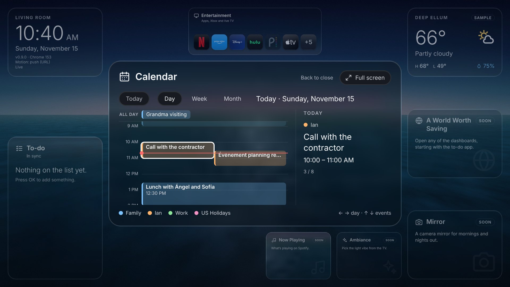

# Home Hub for a Samsung Tizen TV

A custom home screen that runs as a [TizenBrew](https://github.com/reisxd/TizenBrew) app module. One screen of widget tiles, remote friendly.


Out of the box:

- **Today:** the time, the date, the build and whether it is the newest.
- **Entertainment:** Netflix, Prime Video, Disney+, Hulu, Peacock, Apple TV, YouTube (TizenTube), Xbox on HDMI 1, Pluto TV, Twitch and a list of every app on the TV.
- **To-do:** a list kept on the TV. Add, tick off and move things with the remote.
- **Weather:** the temperature, today's high and low and the chance of rain, then the next 12 hours and the week. It finds the TV's city by itself.
- **Calendar:** today's agenda on the tile, then Day, Week and Month in the panel, from your Google calendars through the Pi.
- **Coming soon:** Now Playing, A World Worth Saving, Ambiance and Mirror. These tiles hold their spot with a "Soon" tag until they're built.

Press OK on a tile to open it in a panel in the middle of the screen; the other tiles slide out of the way. The panel has a **Full screen** button. The tiles sit on a picture of the ocean, frosted like glass.

## Install on the TV

1. Open TizenBrew and go to **Module Manager**.
2. Choose **Add GitHub Module** and type `irosen419/tizen-takeover@main`. The `@main` matters: the hub follows the branch you name and always runs its newest commit (see [Updating](#updating)).
3. Back on the TizenBrew list, open **Home Hub**.

Apps that aren't installed show dimmed with "Not installed". Install the app from the Samsung store and reopen the hub.

## Remote

| Button | Home | Widget panel | Full screen | All apps list | Dashboard |
| --- | --- | --- | --- | --- | --- |
| Arrows | Move between tiles | Move between items and the Full screen button | Same as the panel | Up and down | |
| OK | Open the widget | Open the item, or switch to full screen | Open the item, or leave full screen | Open the app | |
| Back | Stays on the hub | Close the panel | Back to the panel | Back to the apps grid | Close the dashboard |

The Home button always goes to Samsung's own home bar. Open the hub from TizenBrew, or set it to start on its own (below).

## Xbox

The TV refuses remote key presses from an app running on itself, so the hub can't switch inputs directly. Two things make the Xbox item work:

1. Turn on HDMI-CEC: Anynet+ on the TV and HDMI-CEC on the Xbox. Then pressing the Xbox button on the controller switches the TV to HDMI 1 by itself.
2. Put a Home Assistant webhook URL in the Xbox item's `url` in `app/config.js`. The item posts to it, Home Assistant wakes the Xbox, and CEC switches the input.

Until `url` is set, the item shows a tip instead.

## Start the hub when the TV turns on

1. In TizenBrew, open **Settings**, then **Autolaunch Settings**, and pick Home Hub.
2. On the TV, turn on **Autorun Last App** (usually under Settings, General, Smart Features).

To get back to TizenBrew's own menu once autolaunch is on, close the hub, open TizenBrew and keep tapping Up while it connects. Up is the only key that skips autolaunch. **Disable Autolaunch** sits at the bottom of Autolaunch Settings.

Do this last, after everything else works, so TizenBrew's own menus stay easy to reach while you set things up. Samsung can still decide to show its own home bar after some updates.

## Settings

Everything lives in `app/config.js`.

### The Raspberry Pi

`HUB_PI` at the top is the Pi's address on the home network. Home Assistant runs there, and so will the later widget apps. Change it in that one place; the Xbox webhook is built from it.

### Layout

`layout` places each widget on a grid 12 columns wide and 6 rows tall. `x` and `y` are the top-left cell, `w` and `h` the size in cells. Make the tiles cover the whole grid so there are no gaps. `start` is the tile that has focus when the hub opens.

### Background and glass

`background` is the picture behind the tiles: a file next to `hub.html` (the default is `backgrounds/ocean.jpg`) or a full web address. Any 1920x1080 picture works; drop it in `app/backgrounds/` and point `background` at it. Set `background: ''` for the plain dark look. If the picture can't load, the hub falls back to the plain dark look by itself.

`glass: true` makes the tiles and panels frosted glass that show a soft blur of the picture behind them. `glass: false` keeps solid dark cards over the picture. A picture from another website still shows, but its glass is a plain tint without the blur, because the TV won't let the hub read pixels from another site.

### Motion

`motion` picks how a panel opens:

- `'push'`: the widget grows into the middle of the screen and the other tiles slide aside and shrink into a ring around it.
- `'expand'`: the widget grows over a dimmed screen.
- `'fade'`: a plain fade, the lightest on slow TVs.
- `'auto'` (the default) starts with push and times it on the TV. If push stutters twice, it drops to expand and times that; if expand stutters twice, it drops to fade for good. Three smooth runs keep the current one. The result is remembered until the next version of the hub.

Set `motion: 'fade'` (or `'expand'`) to pick one yourself. On a laptop, `?motion=push`, `?motion=expand`, `?motion=fade` or `?motion=auto` at the end of the address does the same for one visit.

### The status line

The two small lines at the bottom of the Today tile show the hub version and the TV's browser, then the motion choice, for example `v0.12.1 (newest) · Chrome 63 · Tizen 5.0` and `Motion: push (auto, 57 fps)`. `(newest)` means GitHub confirmed this is the newest commit of the branch. `measuring` means auto is still timing; `(config)` or `(URL)` means the mode was set by hand. One more line shows when live updates have something to say (see [Live updates](#live-updates)), and another when updates do (see [Updating](#updating)).

### Entertainment

`widgets.entertainment.sections` lists the items, in groups. Each item has a `kind`:

- `app` opens an installed app. `match` lists names to look for. The first exact match wins, otherwise the shortest name that contains the text.
- `tizentube` opens the TizenTube module through TizenBrew.
- `input` presses a remote key. This TV refuses key presses from the hub, so it's kept only for TVs that allow it.
- `webhook` posts to a URL, for example a Home Assistant webhook.
- `dashboard` opens a web page full screen, for example Home Assistant or Grafana.
- `allApps` opens the list of every app.

`logo` picks a brand logo from `app/logos.js`. Without one, the item shows its first letter. `sub` is the small line under the name.

The home tile shows the first six logos. The panel shows them all; full screen groups them by section.

#### Adding a dashboard

Uncomment the Dashboards example and point `url` at the page. Some sites refuse to load inside another page. If yours shows blank, that site blocks framing and needs its own setting changed.

### Weather

The tile shows the city, the temperature and the sky now, and today's high, low and chance of rain. The panel has two views, picked with Left and Right at the top: **Day** (now, feels like, wind, rain today, sunrise and sunset, then the next 12 hours with a temperature curve; if the screen is short on room, the hours show their temperatures as a plain row instead of the curve) and **Week** (seven days, each with its rain chance and its low-to-high range on one shared scale). Full screen shows both side by side, under the place's date.

`widgets.weather.location` says where the forecast is for. It takes one of three forms:

- `''` (the default): the TV finds its own city. It asks a public lookup service (ipwho.is, then get.geojs.io if that one doesn't answer) which city its internet address is in, and keeps the answer on the TV, not in this file. If the lookup picked the wrong city, **Wrong city?** in the panel asks again, trying the other service first; the old city stays until the new one's forecast is in. If it still gets it wrong, set the city yourself. If neither service answers (no internet yet), the tile says "Can’t find your city yet" and keeps trying. If they answer but can't place the TV, it says "Set your city": add one to `location`.
- A city name, such as `'Lisbon'` or `'Portland, Oregon'`. It's looked up once. The part after the comma picks between towns with the same name.
- An exact spot: `{ name: 'Home', latitude: 38.72, longitude: -9.14 }`.

`units` is `'fahrenheit'` (wind in mph) or `'celsius'` (wind in km/h).

Forecasts come from [Open-Meteo](https://open-meteo.com/), which is free and needs no account. The panel credits it, as its licence asks. The TV asks Open-Meteo directly; if the TV's browser can't reach it, the hub's local helper (`service.js`) asks for it. The forecast updates every 20 minutes while the hub is on screen, and right away when you come back to the hub after a while. When it can't update, the tile keeps the last forecast and says "as of" and the time it was fetched. After 24 hours without an update the old forecast is dropped and the tile says "No forecast right now" with the time of the next try. **Update now** in the panel tries at once. If the TV's clock jumps back, the hub updates straight away instead of waiting.

## To-do

A to-do list kept on this TV. The tile shows how many things are in **Now**, how many are in Next, Waiting on and Done today, and the first few Now items. Anything past its due date says **Overdue**.

Open the tile to see the whole list, in four parts: **Now**, **Next**, **Waiting on** and **Done today**.

- **Add something:** the box at the top has focus when the list is empty. Press OK and type with the TV's keyboard, then press Done. The new item goes to the top of Now and the box is ready for the next one. Back stops typing and keeps the text.
- **Tick it off:** OK on an item. It stays where it is, crossed out, until you close the list, so a wrong press is fixed with another OK. Next time it shows under Done today. OK on a Done today item puts it back.
- **Move it:** press Right on an item to reach its two round buttons: the arrow moves it along (its label says where: **To Next**, **To Waiting on** or **To Now**), the bin removes it.
- **Remove it:** OK on the bin (**Remove**), then OK again on the red **Confirm**. Moving away or pressing Back cancels.

Done items stay under Done today until the end of the day, then they're cleared.

A USB or Bluetooth keyboard plugged into the TV works too: with the box focused, just start typing, and Enter adds the item. Backspace deletes a letter while you type.

Full screen shows Now on the left and the rest on the right.

The list is saved on the TV itself. With [live updates](#live-updates) on, it is also kept on the Pi and changes go both ways; the line under the title says where the list is: `On this TV` (no Pi), `In sync`, `Saved here, 2 to send` (changed while the Pi was away; sent when it's back) or `Saved here` (the Pi is away, nothing waiting). A warning shows on the tile if something goes wrong:

- **This TV isn't saving the list.** The TV won't let the hub save anything. The list works until the hub closes, then it's gone.
- **Couldn't save the last change.** The TV's storage may be full. The change is kept until the hub closes, and the next change tries again.
- **The saved list couldn't be read, so a fresh one was started.** The saved copy was damaged. It's kept on the TV as `homeHub.todo.v1.bad` in case it can be recovered.

## Calendar

Your calendars, read by the hub server on the Raspberry Pi (see [Live updates](#live-updates) and [pi/README.md](pi/README.md) for the secret iCal links). Everything is shown in the Pi's time zone (`HUB_TIMEZONE`, America/Chicago by default), whatever zone the TV is set to. Each calendar has its own color; the panel's foot names them.



The tile shows today's date, all-day events, then what's still to come today (ended events drop off; one that is on now says **Now**). With nothing left it says "Nothing else today" and the next event, for example "Next: Tomorrow 9:00 AM Dentist".

The panel has three views. The row at the top holds **Today**, **Day**, **Week** and **Month**; Left and Right on it switch views at once, Down goes into the calendar.

- **Day:** the hours of one day with all-day events above them, events side by side where they overlap, a red line for now, and the chosen event's details on the right. Left and Right go to the day before or after; Up and Down pick events. Past events are dimmed.
- **Week:** seven columns, Sunday first (change `WEEK_START` at the top of `app/widgets/calendar.js` for Monday). Left and Right pick the day, Up and Down its events, OK opens that day.
- **Month:** colored dots for days with events and the chosen day's list beside the grid. The arrows move by day and week (into the next or last month at the edges); OK opens the day.

Up from the first event (or the top row of the month) goes back to the row of tabs. **Today** jumps back to today. Back closes the panel, as everywhere.

When something is missing the tile says so in plain words: "Calendar needs the Pi" (live updates off, or the Pi never reached), "Loading the calendar…", "No calendars set up yet" (no links in the Pi's `.env`), "Nothing coming up", "Can't reach the Pi". A calendar the Pi couldn't read shows as "Work: couldn't be read". The TV keeps its last copy of the calendar, so the tile has something to show straight after the TV turns on; when that copy is old and the Pi is away it says "Last updated 2:40 PM".

## Live updates

A small server on the Raspberry Pi (`pi/`) lets Claude steer the screen ("show me the weather", "go home", a short message at the bottom) and keeps the to-do list, so "add milk to my to-do list" shows up on the TV by itself. The TV keeps one open line to the Pi and redraws when something changes. The TV being off, or the Pi being down, never breaks the hub: it draws from what it saved and tries again quietly. The design is in [docs/live-updates.md](docs/live-updates.md); installing and running the server is in [pi/README.md](pi/README.md).

The setting is `live` in `app/config.js`:

```js
live: { server: HUB_PI + ':8097' },
```

`server: ''` turns live updates off, and the hub works exactly as before. On a laptop, `?live=http://127.0.0.1:8097` in the address uses another server for one visit, and `?live=off` turns it off.

The clock tile says how it's going, in small text, never a pop-up:

| The clock tile says | Meaning |
| --- | --- |
| nothing | Live updates are off, or this TV has never reached the Pi (it keeps trying quietly) |
| `Live` | Connected |
| `Live: lost the Pi at 7:10 AM` | Was connected, the Pi can't be reached now. The hub uses saved data and retries |
| `Live: the Pi refused this TV` | The TV isn't on the Pi's allowed list (`HUB_TV_IPS`). Retries every 5 minutes |
| `Live: unexpected reply from the Pi` | Something else answers at that address. Retries every 5 minutes |
| `Live: the hub needs an update` | The Pi's server is newer than this hub understands |

Commands the Pi can send: `show` a widget (`weather`, `todo`, `calendar`, `entertainment`, optionally full screen), `home` (close whatever is open), `say` a short message for a few seconds, and `reload` (which goes through the loader, so it also picks up the newest version). A command sent while the TV is off is dropped, so nothing old fires when the TV turns on.

### For widget authors

Widgets get `ctx.live`: `status()` (`{ state, text, since }`), `get(resource)`, `on(resource, fn)` (`fn(data, rev)` whenever new data arrives), `onStatus(fn)`, `post(path, body, cb)` and `everConnected()`. The hub also calls every widget's `onStatus` hook when the live state changes. `ctx.live` is `undefined` when `live.js` isn't loaded. Normally every file comes from one commit, but when GitHub can't be reached on a TV's first start the hub runs from the branch, where jsDelivr can serve a mix of old and new files, so always check it first. `ctx.setTileSub(text)` changes the small line under the tile's title. The to-do widget (`app/widgets/todo.js`) is the worked example.

### Preview and test

`node dev/preview.js` also runs the Pi's server on `127.0.0.1:8097` (with a made-up token, data in `dev/.live-data`). Open http://127.0.0.1:8090/?live=http://127.0.0.1:8097 and, in another terminal, try:

```
HUB_TOKEN=preview-token-not-a-secret-000000 node pi/hubctl.js show weather
HUB_TOKEN=preview-token-not-a-secret-000000 node pi/hubctl.js say "Dinner in 10"
```

The preview's hub server also reads four sample calendars from a small local feed server (`dev/calendar-sample.js`). `CALENDAR_MODE=empty`, `fail`, `partial`, `many` or `off` at start, or http://127.0.0.1:8095/preview?calendar=MODE while it runs, shows the other states.

`node dev/calendar-test.js` checks the calendar's date logic in Node (days in the Pi's zone, all-day ends, midnight crossings, both 2026 clock changes). `node dev/calendar-shots.js` takes the `docs/screenshots/calendar-*` pictures with the clock fixed at Sunday 15 November 2026, 10:40 AM, and checks the keys on the way (needs port 8095 free).

`node dev/live-test.js` runs the checks from the design doc in a headless browser (Playwright): no server, a server that starts late, commands, the to-do list both ways, the TV off then on, the server stopping, refusals and wrong replies, and the same again on the fallback for old browsers. It needs port 8095 free and nothing from the internet. It can't prove the real TV's browser or the home network; the first run on the TV is still a real test.

`node dev/layout-test.js` checks the tile layout sent from the Pi (`./hub layout set`, see `pi/README.md`) the same way: a saved layout at start, tiles that move in place with focus and glass following, waiting while a panel is open, one reload for a new set of widgets, and no reload loop. It also needs port 8095 free.

## Writing a widget

A widget is one file in `app/widgets/` that registers itself, a `<script>` tag for it in `hub.html` before `hub.js`, and a `layout` entry. To replace a "Soon" placeholder, register a widget with the same `id`; a real widget always wins over a placeholder.

```js
(window.HUB_WIDGETS = window.HUB_WIDGETS || []).push({
  id: 'weather',           // matches the layout entry and HUB_CONFIG.widgets.weather
  title: 'Weather',
  icon: 'sun-cloud',       // a name from app/icons.js
  expandable: true,        // false: a static tile that focus skips
  init: function (ctx) {},              // once at start: timers, loading data
  renderTile: function (el, ctx) {},    // fill the tile body (the hub draws icon and title)
  renderPanel: function (el, ctx) {},   // fill the panel body each time it opens
  onSelect: function (target, ctx) {},  // OK on one of your focusable elements
  onSubmit: function (target, ctx) {},  // Enter or Done in a text box
  onBack: function (ctx) { return false; }, // return true if you handled Back
  onMode: function (mode, ctx) {},      // 'panel' or 'full'
  onClose: function (ctx) {}
});
```

Only `id` and `title` are required. Give every element the remote should reach the class `f`, and `data-autofocus` to the one that gets focus first. Arrows move between them by position.

A text box is an `<input class="f">` (type text or similar). OK on it, or a letter typed on a keyboard, starts typing; on the TV that opens the on-screen keyboard. While typing, the keys go to the box (Backspace deletes, Left and Right move the cursor). Enter or the keyboard's Done stops typing and calls `onSubmit(target, ctx)`, where `target.value` is the text. Back or Cancel stops typing and keeps the text. Up and Down stop typing and move on. Style the typing state with `:focus` and hub focus with `.is-focused`. Give the box a `data-key` so a redraw while typing keeps the text.

Arrows normally move by position. A widget that needs its own rule for some moves adds `onMove(dir, from, ctx)`: return the element to focus, `true` to stay put, or nothing to let the hub decide.

Other optional hooks and fields: `planned`, `head: false`, `sub`, `onFocus` and `onStatus`; the comment at the top of `hub.js` lists them all.

`ctx` gives each widget: `config` (its part of `HUB_CONFIG.widgets`), `toast(text, ms)`, `service(path, ms, cb)` for the TV's service, `getJSON(url, ms, cb)` for any other address, `pi(path)` to build an address on the Pi (`ctx.pi('/todo/')`, `ctx.pi(':8123/api/x')`), `openFrame(url)`, `isOpen()`, `mode()`, `setMode(mode)`, `close()`, `redrawTile()`, `redrawPanel()`, `setSub(text)`, `setTileSub(text)`, `focus(el)`, `live` (see [Live updates](#for-widget-authors)), `updates()` (where this hub stands with updates: `{ state, text, newest, ... }`, or `undefined` without `update.js`), `browser()` (the TV's browser, for example `Chrome 63 · Tizen 5.0`), `hasTizen` and `registerKeys(keys)`.

A widget gets its data from the Pi in one of two ways. It either draws itself from JSON fetched with `ctx.getJSON(ctx.pi('/...'))` (the Pi must send an `Access-Control-Allow-Origin` header), or it opens a page hosted on the Pi full screen with `ctx.openFrame(ctx.pi('/...'))`.

A widget that throws an error shows a short message instead of stopping the hub.

Keep to plain ES5 JavaScript (`var`, `function`, no arrow functions or `fetch`) and animate only `transform` and `opacity`. The TV's browser is old and its graphics chip is slow.

## Preview on a laptop

```
node dev/preview.js
```

Then open http://127.0.0.1:8090/ (it moves on to `/hub.html` by itself; the preview never asks GitHub for anything). It serves `app/` and pretends to be the TV's service with a made-up app list (Peacock is left out on purpose so "Not installed" shows). Launches, keys and webhooks are printed in the terminal instead of happening. Arrows move, Enter is OK and Escape is Back; the mouse works too. Add `?motion=push`, `?motion=expand`, `?motion=fade` or `?motion=auto` to the address to try each animation. YouTube can't open in the preview because there's no TizenBrew.

## Updating

Push to `main`. The TV picks the change up by itself, and nothing needs purging.

How it works: TizenBrew opens `app/index.html` through jsDelivr. That page is a small loader. It asks GitHub for the newest commit on `main` and opens that exact commit's `app/hub.html`, so every file comes from the same commit. jsDelivr never changes a commit once it has it, so nothing old or mixed can show. A normal start takes a fraction of a second longer than before. If it takes more than about a second, the screen says "Getting the newest version…".

While the hub is on screen it asks GitHub again every 15 minutes, and when you come back to it after 5 minutes or more. When there is a newer commit, it waits until nothing is open and the remote hasn't been touched for 2 minutes, then reloads into it. The live `reload` command goes through the loader too, so it also picks up the newest commit.

It can't leave you worse off:

- If GitHub can't be reached, the hub opens the last commit that started on this TV. A TV that has never got that far opens the branch, as it always did.
- If a new commit hasn't started within 15 seconds, the hub goes back to the last one that did, and doesn't try the new one again for 6 hours. Push a fix and the fix is tried straight away.
- If jsDelivr doesn't have the new commit yet, the hub stays where it is and tries again at the next check.

GitHub allows 60 lookups an hour from one home without an account. The hub uses about 4 an hour, plus one each time it starts.

The clock tile says how it's going:

| The clock tile says | Meaning |
| --- | --- |
| `(newest)` after the version | GitHub confirmed this is the newest commit of the branch |
| nothing extra | The hub isn't running under TizenBrew (the laptop preview), or hasn't heard from GitHub yet |
| `Updates: can't reach GitHub` | GitHub didn't answer, or refused (too many lookups). This is the newest version the TV knows of. It asks again later |
| `Updates: a newer version didn't start` | The newest commit didn't start, so the TV went back to this one. It tries again after 6 hours, or straight away when an even newer commit comes |
| `Updates: a newer version isn't ready yet` | jsDelivr can't serve the newest commit yet. It asks again at the next check |
| `Updates: a newer version is ready` | It reloads into it once nothing is open and the remote has been left alone for 2 minutes |

The version on TizenBrew's card for the hub comes from the branch's `package.json` through jsDelivr's cache, so it can lag behind by up to 12 hours. The clock tile is the truth.

A few files still come through jsDelivr's 12-hour branch cache: `package.json`, `service.js`, the loader `app/index.html`, and `app/update.js` as the loader uses it. These rarely change. After changing one of them, purge it at `https://purge.jsdelivr.net/gh/irosen419/tizen-takeover@main/<file>` (for example `.../app/update.js`), or wait 12 hours.

**Once, to get this version onto the TV:** jsDelivr still has the old `app/index.html`, so purge these four files once, then reopen the hub:

- `https://purge.jsdelivr.net/gh/irosen419/tizen-takeover@main/app/index.html`
- `https://purge.jsdelivr.net/gh/irosen419/tizen-takeover@main/app/update.js`
- `https://purge.jsdelivr.net/gh/irosen419/tizen-takeover@main/app/hub.html`
- `https://purge.jsdelivr.net/gh/irosen419/tizen-takeover@main/package.json`

`node dev/update-test.js` tests all of this in a headless browser (Playwright), against a pretend TizenBrew and a pretend GitHub: the first start, a new commit, GitHub away, a broken commit, a commit jsDelivr hasn't got, waiting for a quiet moment, the `reload` command, an old commit from before the loader, damaged memory, the laptop preview, and the clock tile with up to four lines. It needs port 8095 free and nothing from the internet. Set `UPDATE_TEST_SHOTS` to a folder to also save screenshots. It can't prove the real TV, TizenBrew or jsDelivr; the first run on the TV is still a real test.

## How it works

- `app/index.html` is the loader TizenBrew opens. It runs `update.js`, which moves on to the newest commit's `hub.html` (see [Updating](#updating)).
- `app/hub.html` is the hub's page. It loads, in order: `update.js`, `config.js`, `icons.js`, `logos.js`, the files in `widgets/`, `live.js`, then `hub.js`.
- `app/update.js` finds the newest commit for the loader. On the hub's page it checks for newer ones, and goes back to the last good one if a new one doesn't start.
- `app/live.js` keeps the line to the Pi's server for live updates. It does nothing until `hub.js` starts it.
- `app/config.js` holds the settings.
- `app/icons.js` holds the white line icons; `app/logos.js` the app logos.
- `app/widgets/` holds one file per widget: `today.js`, `entertainment.js`, `todo.js` (with its styles in `todo.css`), `weather.js` (with its styles in `weather.css`) and `planned.js` (the "Soon" placeholders).
- `app/hub.js` builds the home screen, moves focus, opens panels and runs the animations.
- `app/style.css` holds the hub's styles; a widget can bring its own stylesheet, like `widgets/todo.css`.
- `app/backgrounds/` holds the background picture.
- `service.js` runs inside TizenBrew's Node service on the TV. It listens on `127.0.0.1:8095` only and lists apps, opens apps, calls webhooks and fetches the weather when the page can’t do it directly.
- `dev/preview.js` is for previewing on a laptop and isn't used on the TV; `dev/live-test.js` tests live updates end to end; `dev/layout-test.js` tests the tile layout from the Pi; `dev/update-test.js` tests updating.
- `pi/` is the live updates server for the Raspberry Pi (see `pi/README.md`).

All of `app/` is plain ES5 JavaScript so the TV's older browser can run it.
