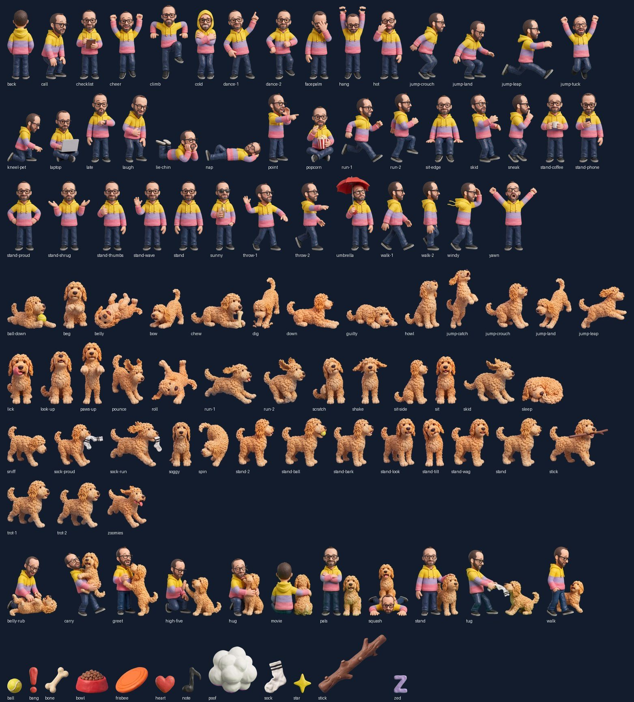

# Clay characters

Ian and Ember as stop-motion clay puppets, for the hub to animate. Nothing here runs on the TV; the finished sprites are in `app/clay/`.

## What's where

- `models/` holds the two turnaround sheets and three test shots. The sheets are the reference for every pose, so a new pose still looks like the same puppet.
- `raw/` holds the pose sheets as Gemini drew them: one row of poses on a green or blue backdrop.
- `tools/` turns those into sprites (below).
- `app/clay/sprites/` holds the sprites: transparent WebP, in `ian/`, `ember/`, `duo/` (both in one picture) and `props/`.
- `app/clay/sprites.json` lists them. `unit` is Ian's standing height in sprite pixels (400, about twice his size on the 1080p hub); every sprite is drawn to that one scale. Each sprite has its `file`, `w` and `h`, `cx` (the horizontal middle of its weight, steadier than the middle of the box when frames change), `faces` (`right`, `front` or `back`; mirror a `right` sprite to go left) and `about`. `sequences` names frames that play in order, such as `ian.run` and `ember.jump`.

## Adding poses

It needs Python 3 with `pillow`, `numpy` and `scipy`, and a Gemini key in `GEMINI_API_KEY`.

1. Describe the poses in `tools/sheets.py`: add a `sheet(...)` with five or six poses. The first must be an upright standing pose, because its height sets the scale for the whole sheet. Use a green backdrop for Ian (his jeans are blue) and a blue one for Ember and anything with a tennis ball in it (the ball is nearly green).
2. `python3 art/clay/tools/gen.py my-sheet` asks Gemini for the sheet and saves `raw/my-sheet.jpg`. Each run costs one image.
3. Look at it. Gemini strays: it adds or drops a pose, stacks two, draws a logo, forgets the glasses. Say what it actually drew with `found=[...]` (a name per pose, `None` to throw one away), `rows=`, `join=` and `scales=`; `sheets.py` has examples of each. Redo anything that is wrong in a new sheet.
4. `python3 art/clay/tools/cut.py my-sheet` removes the backdrop and cuts one picture per pose into `cut/` (not kept in git). It prints how many poses it found.
5. `python3 art/clay/tools/export.py app/clay` rebuilds every sprite and `sprites.json`. It needs every sheet cut first: `cut.py` takes several names.
6. `python3 art/clay/tools/review.py out.jpg app/clay/sprites/ian` lays one folder of sprites out side by side to check heads are the same size.

Only the puppets and the photo crops they were first made from ever went to Gemini. The photos are not in this repository.
